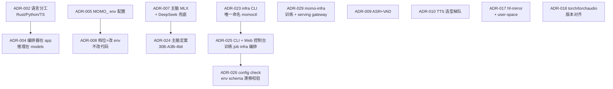

# 决策汇总（ADR）

> 本文件收 infra/模型侧决策；产品与 app 决策见 [momo 仓](https://github.com/Momoyeyu/momo)。
> 所有已确认设计决策的单点定论。每条：标题 + 决策 + 理由 + 被否选项。其他文档引用结论，不重述理由。
> 状态均为「已锁定」，除非特别注明。推翻任何一条都需要先改本文档。编号沿用 momo 主仓原始编号，不连续处即分流到产品侧的条目。

## 仓库与工程

### ADR-002 语言分工：Rust=运行时与工具，Python=模型，TS=薄前端

- **决策**：Python 只做模型相关业务；Rust 做应用运行时与 infra 小工具；TS 仅限薄前端。Rust 生态不足处允许单独引入 C++ 组件，**须文档注明理由**。
- **理由**：模型生态（torch/onnx/MLX/训练脚本）全在 Python；回合状态机要稳定并发、低延迟、可分发单二进制；前端只需渲染与音频 IO。
- **被否**：全 Python（GIL 下并发管线与分发都吃力）；全 Rust（模型绑定生态不足，推理侧会反复造轮）。

### ADR-005 一切环境差异走 `MOMO_` 环境变量

- **决策**：环境差异与密钥全部走 `MOMO_` 前缀环境变量；仓库只提交 `.env.example`（占位无值），本地 `.env` 不入库；兼容后续配置发布平台。规范见 [../01-architecture/config.md](../01-architecture/config.md)。
- **理由**：密钥不进 git；env 是部署平台最通用的注入面；降级切换=改 env。
- **被否**：配置文件入库（密钥泄露风险、多机差异难管）；CLI-only（对配置发布平台不友好，且长参数难维护）。

### ADR-023 infra CLI 唯一命名 `momoctl`

- **决策**：momo-infra 的命令行工具唯一名字是 `momoctl`；子命令集：`doctor` / `pull [--check]` / `serve up|down|status|logs|restart` / `switch --to` / `bench` / `gc` / `web`（ADR-025）/ `config check`（ADR-026）。
- **理由**：与产品名 `momo` 及进程名 `momod` 区分开，避免把产品名直接当命令用的歧义；`kubectl`/`systemctl` 同类惯例。
- **被否**：以 `momo` 作 CLI 名（与应用主体/产品同名易混）；`momoctl models verify|gc` 独立子命令树（作废，verify=`pull --check`、gc=`gc`）。

### ADR-025 infra 扩展为「CLI + Web 控制台」，训练 job 由 infra 编排、models 执行

- **决策**：`momoctl web` 子命令起 axum 控制台（REST + SSE + 内嵌静态 SPA），覆盖组件起停/模型管理/训练 pipeline/env 配置四块运维面；训练 job 状态机（queued→preparing→running→succeeded/failed/canceled→promoted）由 infra `jobs/` 编排，执行器分本地子进程与 SSH 远程（4090D/mac-studio），训练实体脚本仍在 momo-models `training/`。CLI 与 Web 共用同一核心与 `--json` schema（详见 [`../02-repos/momo-infra.md`](../02-repos/momo-infra.md) Web 专节）。
- **理由**：用户明确需求（2026-10-11）——web 页面操作 infra、管理推理与训练、模型选择与微调 pipeline、常见配置；单 binary 内嵌 SPA 保住单文件分发与 bootstrap 独立性；训练实体与编排分离守住「infra 无推理」硬约束。
- **被否**：独立 momo-web 仓/进程（多一套分发与版本对齐，收益不足）；Gradio 式 Python UI（引入 Python 依赖，违背 infra bootstrap 独立约束）；训练编排放 momo-models（模型仓不该管进程/ssh/状态目录等机器运维）。

### ADR-026 `momoctl config check`：env schema 漂移校验 + 敏感项默认纪律

- **决策**：`momoctl` 新增 `config check` 子命令，只读比对 `config.schema.toml` ↔ 三侧 `.env.example` ↔ `config.md`（CI `ci-config.yml` 门禁）。schema 校验实装敏感项纪律：密钥型敏感项（`string`/`url`/`path`）`default` 必须为空；开关型敏感项（`bool`/`enum`/`int`，如 `MOMO_DATA_KEEP_AUDIO`）保留安全常量默认；两类 `examples` 均不得覆写为真实值（只允许等于 `default`）。
- **理由**：密钥/凭据不能入库，`default` 留空从源头杜绝默认值泄钥；`examples` 覆写会经 `expected_entries` 反向要求真实值写进 `.env.example`。开关型敏感项的"敏感"指产物隐私（保留音频），安全常量 `off` 正是要固化的默认，置空反而丢掉安全默认并破坏 enum 取值校验。
- **被否**：敏感项一律空默认（`MOMO_DATA_KEEP_AUDIO` 等开关型被迫无默认，enum 校验与"安全默认"语义双输）；敏感项 `examples` 放开覆写（`sk-...` 类真实值可入库）。

### ADR-029 momo-infra：自有训练 + serving，复用开源底座，统一对外 gateway

- **决策**：`momo-infra` 是自有的 AI 基础设施——LLM 后训练、ASR/TTS 全训练 pipeline，以及模型 serving 能力。推理底座**复用开源实现**（vLLM 等），不手搓推理引擎/KV cache；自研部分收敛到**统一对外 gateway**：对内可配置多模型容灾与负载均衡，对外暴露单一接口；ASR/TTS 对外接口形态对齐主流云服务（REST/WS 标准协议），使 app 的 provider 配置同时兼容 momo-infra 与第三方云服务。
- **理由**：推理引擎是已被开源解决的深水区，自研无差异化价值；差异化价值在「自有模型的训练→评测→部署」闭环与一个对 app/用户透明的稳定入口。
- **被否**：自研推理引擎/KV cache（重复造轮）；把 gateway 编排放进 app（同 ADR-028）；ASR/TTS 用私有协议（抬高 app 与第三方服务的对接成本）。

## 架构与协议

### ADR-004 编排器放 momo-app（Rust），模型推理放 momo-models（Python）

- **决策**：编排器（tokio+axum）与前端同属 `momo-app`；ASR/TTS/LLM 接入与训练在 `momo-models`；边界细则见 momo 仓 `01-architecture/boundaries.md`。
- **理由**：推理代码迭代快、依赖重（torch/onnx 数 GB），独立成 Python 服务按需起停；编排器轻依赖、要随前端/桌面壳一起分发。
- **被否**：推理内嵌 Rust（ort/candle 对目标模型生态覆盖不足）；编排放 Python（回到 ADR-002 被否理由）。

### ADR-008 档位切换 = 改 env，不改代码

- **决策**：正常档（交互端 Mac Air/laptop + 编排器 laptop + 大脑 mac-studio MLX）与降级档（laptop 单机全栈 + 小模型/DeepSeek）用**同一套协议与代码**，只切 endpoint 配置。档位切换是 **momo-infra 运维面**职责（`momoctl switch`），不属于 app 的 provider 容灾（ADR-028）。
- **理由**：mac-studio 是借来的随时可能收回；bigstrong vLLM 实测 502 不通（2026-10-10）证明依赖外部必须有降级路径。
- **被否**：单独维护降级分支/构建（代码分叉即腐烂）；人工改代码切模型；在 app 内做多 endpoint 自动 failover（ADR-028：那是服务侧/gateway 职责）。

## 模型选型

### ADR-007 主脑 = mac-studio MLX，Qwen3-8B-4bit 起步

- **决策**：主脑用 mac-studio 上 MLX 跑 Qwen3-8B-4bit（**实测** 2026-10-10：121 tok/s、峰值内存 4.7GB，已达标）；30B-A3B-4bit 实测达标后已升为主脑（见 ADR-024），8B-4bit 保留为备档。降级=laptop 本地小模型或 `deepseek-v4-flash`。机会型副脑=bigstrong 常驻 vLLM qwen3.8-27B-FP8（理论每人 30–45 tok/s，**实测 2026-10-10 服务 502 不通**，待主人修）。
- **理由**：512GB 统一内存跑 MoE 无压力；本地优先保护隐私。
- **被否**：laptop 常驻 8B（8GB 显存要与 TTS 抢）；云 API 做主脑（依赖网络+隐私，只当兜底）。

### ADR-009 ASR = SenseVoice-Small（sherpa-onnx）+ VAD = silero-vad

- **决策**：ASR 用 SenseVoice-Small 走 sherpa-onnx 纯 CPU（**实测** 2026-10-10：laptop CPU×4 RTF 0.040，8.4s→337ms；zh/en/ja/ko/yue + 自动语言检测 + 情感/事件标记）；VAD 用 silero-vad；**不训练**。
- **理由**：CPU 就够不占显卡，语言覆盖满足中/英/日要求。
- **被否**：Whisper turbo（~6GB VRAM 或 CPU 慢档；语言广度不够时再评估）；云端 ASR（违背本地优先）。MeloTTS 的否决见 ADR-010。

### ADR-010 TTS 梯队：CosyVoice3 首选 / GPT-SoVITS 备选 / Kokoro+F5 兜底 / edge-tts 仅过渡

- **决策**：目标是声线克隆型 TTS。首选 **Fun-CosyVoice3-0.5B**（9 语言含中日英、双向流式官方标称 150ms、instruct 情感控制、有训练脚本；实际部署需求**待实测**）；备选 **GPT-SoVITS**（MIT，zh/en/ja/ko/yue，官方标 4060Ti RTF 0.028，零样本 5s/少样本 1min，生态最成熟）；已实测兜底 **Kokoro-82M**（实测 2026-10-10：首包 209ms、RTF 0.023、VRAM 0.76GB）与 **F5-TTS v1**（实测：零样本 RTF 0.535、VRAM 0.8GB）；edge-tts（实测：首包 1937ms）仅作管线过渡。
- **理由**：克隆声线是产品目标；梯队保证每一档都有已验证退路。
- **被否**：**MeloTTS**（laptop 无 sudo，fugashi 依赖系统 MeCab 装不了——已否决）；edge-tts 长期用（1937ms 首包远超 1.5s 指标，且依赖外网）。

### ADR-024 主脑定案 Qwen3-30B-A3B-4bit

- **决策**：主脑由 Qwen3-8B-4bit 升级为 **Qwen3-30B-A3B-4bit**，跑在 mac-studio MLX（`mlx_lm.server :7820`）。**实测 2026-10-10（M3 Ultra）：121 tok/s、峰值 17.2GB**。8B-4bit 同为 121 t/s，保留为备档/二级兜底。
- **理由**：MoE 激活 3B 使生成速度与 8B dense 持平而回答质量更高；512GB 统一内存无压力。
- **被否**：继续常驻 8B-4bit（同速但更弱，降为备档）；32B dense（同显存档下 MoE 更快）。

## 环境约束（硬事实，写文档/代码时视为前提）

### ADR-017 laptop 必须走 hf-mirror，只能 user-space 安装

- **决策**：laptop 访问 huggingface.co 不通，必须 `HF_ENDPOINT=https://hf-mirror.com`（mac-studio 直连慢，镜像同样更快）；PyPI 同理走镜像。laptop **无 sudo**，一切安装必须 user-space（uv/venv/cargo）。
- **理由**：网络实测结论（2026-10-10），不是偏好。
- **被否**：依赖系统包管理器的方案（无 sudo 不可行，MeloTTS 即因此否决）。

### ADR-018 torch 与 torchaudio 版本严格对齐

- **决策**：momo-models 中 torch/torchaudio 版本成对锁定（已踩坑）。
- **理由**：版本错位导致过实际故障。
- **被否**：交给解析器自由解析。

## 检查表

- [ ] 每条 ADR 含：决策、理由、被否选项
- [ ] 实测数据均标注「实测 + 日期」，未达标量标「预估/待实测」
- [ ] GPU 写法统一为 **RTX 3070 Laptop（8GB）**，无 Ti 后缀
- [ ] CosyVoice3 部署需求写「待实测」，不引用旧稿 ~5GB 未验证估计
- [ ] 其他文档只引用本文档结论，不重述理由
