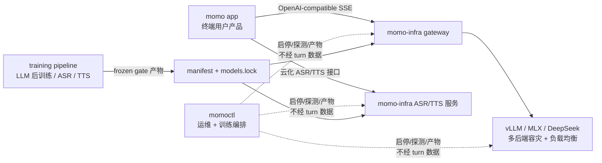

# momo-infra：自有 AI 基础设施

> momo-infra 是自有的 AI 基础设施仓（ADR-029）：LLM 后训练、ASR/TTS 全训练 pipeline、模型 serving 与统一对外 gateway。
> 它不是给终端用户的产品——终端产品是 [momo](https://github.com/Momoyeyu/momo)（app 仓），通过标准 provider 接口消费本仓暴露的能力。

## 目标

建成「自有模型的训练 → 评测 → serving」闭环：

1. **训练**：LLM 后训练（persona/QLoRA）、ASR/TTS 全训练 pipeline（声线克隆 zero-shot/SFT），训练 job 由 `momoctl` 编排，执行器覆盖本地子进程与 SSH 远端（4090D/mac-studio）。
2. **评测**：frozen eval gate 守门——声线走盲听 A/B，persona 走回归题集，不达标不 promote。
3. **Serving**：产物经 manifest + checksum 校验后原子 activate，保留 N-1 代可回滚。

## 边界

- **复用开源推理底座**：LLM serving 用 vLLM 等现成实现，不手搓推理引擎/KV cache（ADR-029）——推理是已被开源解决的深水区，自研无差异化价值。
- **自研收敛到两处**：统一对外 gateway（对内多模型容灾与负载均衡，对外单一接口）与训练/运维编排（`momoctl` CLI + Web 控制台 + jobs/pipeline runner）。
- **infra 不进数据通路**：运维面只做启停、探测、产物管理，不读取对话内容，不转发 turn 音频/文本。

## 对外接口

- **LLM**：单一 OpenAI-compatible `/chat/completions` 接口；app 只需一个 `MOMO_LLM_ENDPOINT`，上游是 vLLM / MLX / DeepSeek / momo-infra gateway 对它透明。
- **ASR/TTS**：对外接口形态对齐主流云服务（REST/WS 标准协议），使 app 的 provider 配置同时兼容 momo-infra 与第三方云服务。

## 与 momo 仓的关系

app 侧只持有单槽位 provider 配置（ADR-028：每类能力一个 endpoint，容灾在服务侧）；本仓对内做多模型容灾与负载均衡，对 app 始终是单一稳定入口。

## 仓内模块

| 目录 | 内容 |
|---|---|
| `infra/` | `momoctl` CLI + Web 控制台 + jobs/pipeline 编排（Rust） |
| `models/` | Python inference adapters + 训练实体脚本 |
| `site/` | 本文档的 VitePress 站点 |
| `docs/` | 设计文档（单一来源） |
