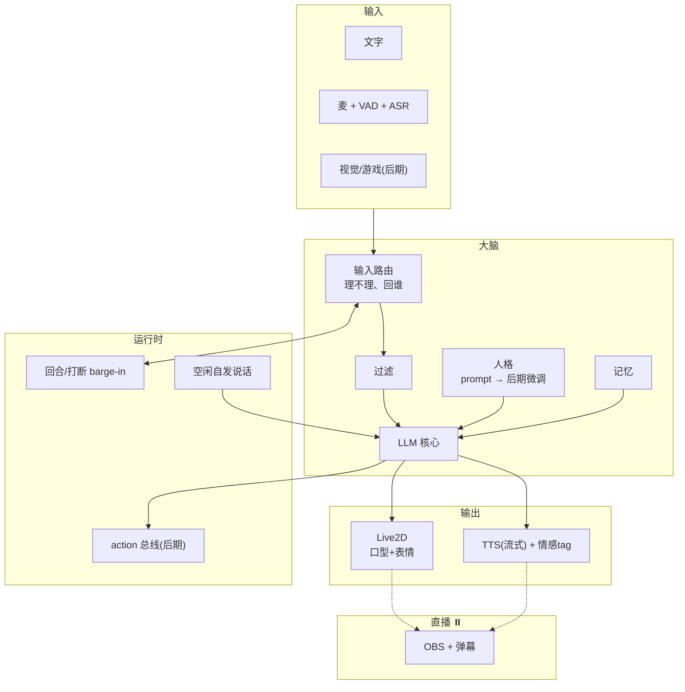
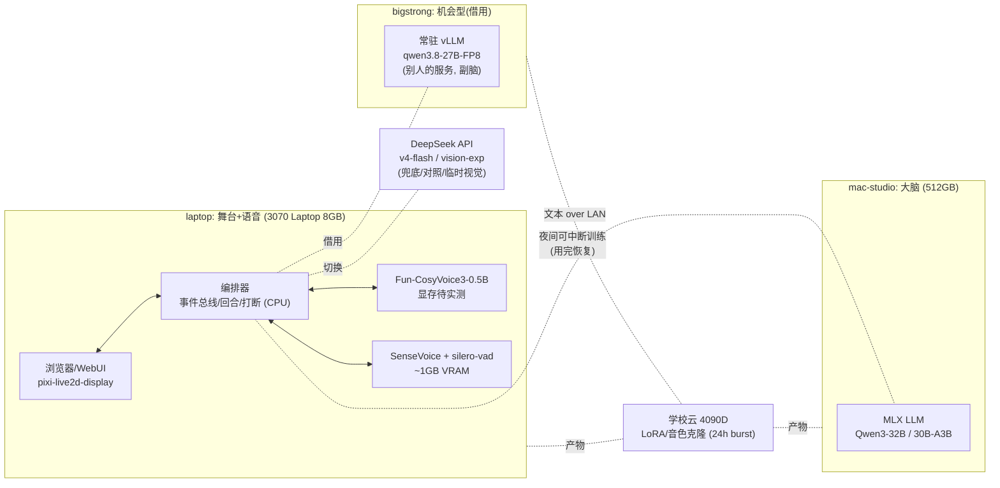
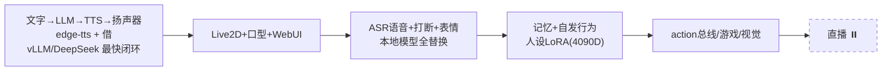

# momo 调研：AI VTuber 模块草稿

> Neuro-sama 式 AI streamer。先本地跑起来，直播暂缓。
> 默认中文，但中/英/日都要能说。形象 Live2D，用免费公开模型。
> 只是粗粒度调研，细节开发时再定。
> **注：本稿为迁仓前的早期调研记录（写作于 momo monorepo 时期，覆盖整条产品线），最终选型与口径以 [decisions.md](./decisions.md) 为准。**
> 对 infra 的参考价值集中在「算力盘点」「实测数据」「技术栈」三节——它们仍是训练/部署机器与模型选型的基线；产品与交互层内容见 [momo 仓](https://github.com/Momoyeyu/momo)。

## Neuro-sama 实际是什么

不是单模型，是一条流水线：

- 定制微调 LLM（人格在权重里，prompt 只给情境）
- TTS 说话 + 独立模型唱歌；Evil Neuro 是另一套配置
- STT / 视觉 / 弹幕多种输入
- 游戏走 WebSocket action 协议（neuro-game-sdk）：游戏注册带 schema 的 action，LLM 只出结构化指令，执行下沉
- 独立过滤层（2023 被封后加的）
- Live2D 皮

启示：模块化、LLM 输出结构化、低延迟是核心体验。微调放后期，前期 prompt + 记忆够用。

## 模块划分

## 算力盘点

| 机器 | 配置 | 定位 |
|---|---|---|
| mac-studio | M3 Ultra, 512GB 统一内存 | **推理主力（借来的实验室机器，可随时被收回）**：大脑 MLX 在这 |
| laptop | WSL2, **RTX 3070 Laptop 8GB** | **舞台+语音**：Live2D 渲染 + 音频 IO + TTS + ASR，音频路径全本地 |
| bigstrong | Linux, 2× 4080 SUPER 32GB。**借来的**：常驻 vLLM（qwen3.8-27B-FP8, TP=2）必须一直跑，日常只剩 ~8GB/卡 | **机会型**：借用他的 endpoint 当副脑；夜间可偶尔中断训练（用完恢复），白天不动 |
| 学校云 4090D×2 | 24GB×2, 单次 24h 自动释放 | **训练主力**：LoRA 微调、TTS 音色克隆，产物拷回 mac-studio |
| DeepSeek API | `v4-flash`/`v4-pro` 文本+工具调用；`v4-flash-vision-exp` 还支持图片输入；无音频 | 兜底大脑 / 对照组 / 临时视觉输入 |

### 各模块资源需求

| 模块 | 需求 | 能放下哪 |
|---|---|---|
| 大脑 LLM 7-8B Q4 | ~5-6GB VRAM | 3070 Laptop（但质量一般） |
| 大脑 LLM 14B Q4 | ~10GB | 4090D / mac-studio 轻松 |
| 大脑 LLM 30B+ (32B Q4 / 30B-A3B / 27B FP8) | ~18-24GB | **mac-studio**（512GB 无压力）/ 借用 bigstrong |
| TTS Fun-CosyVoice3-0.5B | 显存需求**待实测**（CPU 不可实时） | **3070 Laptop**（待实测） |
| TTS Kokoro-82M / MeloTTS | **实测 0.76GB** / 1-2GB | 3070 Laptop 随便放 |
| ASR SenseVoice-Small | **实测纯 CPU 就够** | 随便哪台 |
| VAD / Embedding / Live2D / 编排器 | 忽略 | CPU / 浏览器 |

### 实测数据（2026-10-10，laptop + mac-studio）

| 项 | 环境 | 实测 |
|---|---|---|
| edge-tts 首包 | laptop→微软云 | **1937ms**（8.4s 音频总 3.2s）——能用但偏慢 |
| SenseVoice-Small ASR | laptop CPU×4 | **RTF 0.040**（8.4s→337ms）——CPU 完全够，不占显卡 |
| Kokoro-82M TTS | laptop 3070 CUDA | **首包 209ms，RTF 0.023，VRAM 0.76GB**——本地 TTS 无瓶颈 |
| F5-TTS v1 零样本克隆 | laptop 3070 CUDA | **RTF 0.535，VRAM 0.8GB**——克隆路线可行，快于实时 |
| MLX Qwen3-8B-4bit | mac-studio M3 Ultra | **生成 121 t/s**，峰值内存 4.7GB——主脑候选已达标 |
| MLX Qwen3-30B-A3B-4bit | mac-studio | **实测 121 t/s、峰值 17.2GB**（2026-10-10，M3 Ultra）——已升为主脑（见 decisions.md ADR-024） |
| bigstrong vLLM | qwen3.8-27B-FP8 | **当前 502/不通**，进程在但 API 挂，待主人修 |
| DeepSeek API | — | key 未部署到机器，待补测 |

环境备注：laptop 访问 huggingface.co 不通，**必须 `HF_ENDPOINT=https://hf-mirror.com`**；mac-studio 直连慢、镜像更快。MeloTTS 装不了（fugashi 要系统 MeCab，无 sudo）。

结论：**服务端和舞台分离，WebSocket 连**。最优雅的摆法是 **laptop 把"声音"全包了**（TTS+ASR+VAD 都在 3070 Laptop 上，和麦/扬声器零跳数），**mac-studio 只出大脑**，网络上只走文本。

## 技术栈（已收紧）

| 模块 | 决定 | 一句话理由 |
|---|---|---|
| 服务框架 | **Rust（momod）编排器 + Python 模型服务**（原全 Python 异步框架选型已作废） | 状态机/打断要可预测延迟与单二进制分发；推理与训练生态全在 Python |
| 大脑 LLM | **mac-studio MLX**：Qwen3-30B-A3B(MoE快) / 32B；副脑借 bigstrong 常驻 `qwen3.8-27B`；兜底 `deepseek-v4-flash` | 统一 OpenAI 兼容接口，三家热切换 |
| TTS | **laptop 3070**：首选 Fun-CosyVoice3-0.5B 声线克隆（显存待实测）；GPT-SoVITS 备选；Kokoro 已实测兜底 (209ms/0.76GB)；先用 edge-tts 验证管线 | 音频路径全本地；克隆见下 |
| 声线克隆 | **零样本**：CosyVoice3/IndexTTS-2 只要 ~10-30s 干净参考音，无需训练；**SFT**：10-60min 素材 + 4090D 单卡 24h 内（GPT-SoVITS 更轻） | 用户已有目标声线，先攒参考音频 |
| ASR | **laptop 3070 上 SenseVoice-Small** + silero-vad（~1GB，CPU 也行） | 中日韩粤 + 低延迟 |
| Live2D | pixi-live2d-display + 官方免费 sample 模 | 浏览器直渲，WebSocket 推参数；口型先音量 RMS |
| 人格 | character card + system prompt；后期 4090D 上 QLoRA | 先 prompt 逼近，Neuro 式权重人格是后期课题 |
| 记忆 | sqlite-vec + BGE-M3 | 后期再做，先纯 context |
| 动作总线 | 照抄 neuro-game-sdk：WS 注册 action + JSON Schema | 后期扩展 |
| 训练流 | 4090D burst 训练 → 产物回传 mac-studio；bigstrong 夜间中断当备胎 | 24h 限制正好约束实验周期 |

延迟预估（文字回合）：LLM 首 token <300ms + TTS 首 chunk ~300ms → **~1s 内出声**，达标。

## 演进顺序

起步全部走现成 API/云端，验证编排器和管线；语音闭环成立后逐步换成本地自托管模型。

## 开放问题

- ~~3070 余量~~ / ~~MLX 延迟~~：已实测化解——TTS 1GB 级 + ASR 纯 CPU，8GB 显卡余量大；8B 与 30B-A3B 均实测 121t/s
- **声线基座待试听**：F5-TTS 克隆已跑通（RTF 0.54），但要和 CosyVoice3/IndexTTS-2 盲听对比选基座，质量优先
- **借 vLLM**：27B FP8 TP2 理论每人 30-45t/s 够用，但 `max-num-seqs=3` 与主人共享只当副脑；⚠️ 实测时服务 502 不通
- **DS key 未部署**，跑通闭环前配上
- **人格浓度**：prompt 聊久了会变回助手腔，LoRA 微调是解药，需要攒对话数据
- **版权**：Live2D 免费模型和克隆音色的直播/商用 license，直播前必须确认
- **code-switching**：一句混中日英时 TTS 表现要实测，可能按句切语言路由
- **歌声**：独立子系统（so-vits/RVC 方向），远期再说

## 参考实现

- [Open-LLM-VTuber](https://github.com/Open-LLM-VTuber/Open-LLM-VTuber)：最完整同类，流式管线 + agent 分层，ASR 同款 SenseVoice
- [AIRI](https://github.com/moeru-ai/airi)：TS 栈、插件化、stage 抽象
- [kimjammer/Neuro](https://github.com/kimjammer/Neuro)：7 天最小复刻，Signals 中枢
- [neuro-game-sdk](https://github.com/VedalAI/neuro-game-sdk)：官方 action 协议
