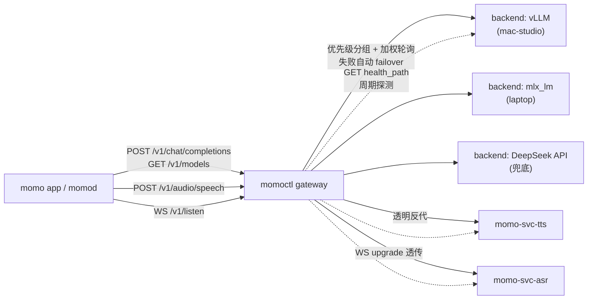

# Gateway：统一对外接口 + 内部容灾/负载均衡

> ADR-029：推理底座复用开源实现（vLLM / mlx_lm 等），自研收敛到统一对外 gateway。
> 对内：多模型 backend 的容灾与负载均衡；对外：单一 OpenAI-compatible 接口 +
> 对齐主流云服务形态的 ASR/TTS 端点。app 只持有一个 `MOMO_LLM_ENDPOINT` /
> `MOMO_ASR_ENDPOINT` / `MOMO_TTS_ENDPOINT`，全部指向 gateway。
>
> 实现：`momoctl gateway`（`infra/src/gateway/`），axum + tokio，TLS 一律 rustls。

## 1. 定位与数据流



职责边界：

- gateway **只做转发与健康管理**，不实现推理、不改写请求/响应语义（OpenAI 字段透传）。
- ASR/TTS 上游服务的协议形态由 `models/` 侧 svc 定义（Deepgram 式 ASR WS、OpenAI 式
  TTS `/v1/audio/speech`）；gateway 对它们只透明反代，不感知 payload。
- infra 不进 turn 数据通路的约束不变：gateway 是数据面组件，但不落盘、不解析对话内容。

## 2. 配置

配置文件为 TOML，路径解析顺序：`--config` > `MOMO_GATEWAY_CONFIG` > `./gateway.toml`；
监听地址解析顺序：`--listen` > `MOMO_GATEWAY_LISTEN` > 配置 `listen` > `127.0.0.1:7830`。

入库样例见 `infra/gateway.example.toml`：

```toml
# ===== 全局策略 =====
listen = "127.0.0.1:7830"          # 监听地址（默认 127.0.0.1:7830）
request_timeout_ms = 60000         # 单次上游请求超时
max_attempts = 3                   # 单请求最大尝试次数（含首次，即 failover 上限 +1）
cooldown_threshold = 3             # 连续失败达到即熔断
cooldown_ms = 30000                # 熔断冷却时长
health_interval_ms = 10000         # 后台健康探测周期（0=关闭后台探测）

# ===== LLM backends：优先级分组内加权轮询 =====
# priority 越小越优先（0=主力组）；同组内按 weight 加权轮询。
[[llm.backends]]
name = "mac-studio-vllm"
endpoint = "http://mac-studio:7820"   # base URL，不含 /v1；转发时拼客户端原始 path
priority = 0
weight = 2
health_path = "/healthz"              # 可选；默认 "/healthz"
api_key = ""                          # 可选；非空则覆盖客户端 Authorization

[[llm.backends]]
name = "laptop-mlx"
endpoint = "http://127.0.0.1:7821"
priority = 0
weight = 1

[[llm.backends]]
name = "deepseek"
endpoint = "https://api.deepseek.com"
priority = 1                          # 兜底组：仅当 priority 0 组全部不可用时进入
weight = 1
# api_key 建议走 env 展开（见下）而非明文入库

# ===== ASR / TTS upstream：透明反代 =====
# paths 为 gateway 侧对外路径，请求 path+query 原样拼到 endpoint 后转发；
# WS upgrade 自动透传。默认路径：asr=["/v1/listen"]，tts=["/v1/audio/speech"]。
[asr]
paths = ["/v1/listen"]

[[asr.upstream]]
name = "svc-asr"
endpoint = "ws://127.0.0.1:7810"      # ws/wss 或 http/https 均可（协议按 ws 语义升级）
health_path = "/healthz"

[tts]
paths = ["/v1/audio/speech"]

[[tts.upstream]]
name = "svc-tts"
endpoint = "http://127.0.0.1:7811"
health_path = "/healthz"
```

规则：

- `endpoint` / `api_key` 中的 `${ENV_NAME}` 在加载时展开为环境变量（密钥不明文入库）。
- `weight` 缺省 1；`priority` 缺省 0；`health_path` 缺省 `/healthz`。
- ASR/TTS upstream 与 LLM backend 共用同一套健康模型与顺序重试，区别只在
  upstream 不分组（视为单一 priority 0 组、等权重轮询）。

## 3. 容灾语义

### 3.1 候选排序（每次请求现场计算）

1. 按 `priority` 升序分组；低 priority 组整体排在高 priority 组前。
2. 组内：未熔断 backend 按 weight 展开加权列表，以组级轮询游标取起点轮转
   （weight=2 的 backend 在列表中出现两次）。
3. 组内熔断中的 backend 追加到该组尾部作为最后手段（fail-open：全组熔断时
   仍尝试，避免健康状态滞后造成的全拒）。
4. 尝试序列取前 `max_attempts` 个。

### 3.2 失败判定与 failover

对同一请求顺序重试下一候选，触发条件仅限：

- 连接错误 / DNS / TLS 握手失败；
- 请求超时（`request_timeout_ms`）；
- 上游响应 5xx。

**4xx 不 failover**（视为客户端错误直接透传），已发出响应头的流式响应不再重试
（SSE 流中途断开不重放，客户端自行重连）。

### 3.3 熔断与恢复

- 每次失败 `consecutive_failures += 1`；达到 `cooldown_threshold` 置
  `cooling_until = now + cooldown_ms`；成功一次即清零。
- 后台探测：每 `health_interval_ms` 对每个 upstream 发起 `GET endpoint+health_path`，
  2xx 记成功（清零并解除熔断），非 2xx / 超时按失败累计。
- 熔断中的 backend 不参与正常 LB（见 §3.1 第 3 条例外）。

## 4. 对外端点

| 方法 | 路径 | 去向 | 说明 |
|---|---|---|---|
| POST | `/v1/chat/completions` | llm pool | OpenAI-compatible；SSE `stream:true` 透传 |
| GET | `/v1/models` | llm pool | 同上 failover 语义 |
| ANY | `/v1/{*rest}` | llm pool | 兜底转发（embeddings 等未来端点同语义） |
| POST | `/v1/audio/speech` | tts upstreams | OpenAI TTS 形态；透明反代 |
| GET(WS) | `/v1/listen` | asr upstreams | Deepgram 形态；WS upgrade 透传（双向帧中继） |
| GET | `/healthz` | 本地 | 进程存活，恒 200 |
| GET | `/readyz` | 本地 | 聚合健康：存在配置了 upstream 但全员熔断的池 → 503，否则 200 |
| GET | `/metrics` | 本地 | 纯文本计数（请求/失败/failover/熔断） |

鉴权：客户端 `Authorization` 头原样透传；backend 配置了 `api_key` 时覆盖。
gateway 自身不校验 token（对内组件；对外暴露由部署层收口）。

## 5. 与 momo app 的对接

app 侧配置不变，只把端点指向 gateway：

```dotenv
MOMO_LLM_ENDPOINT=http://gateway-host:7830/v1
MOMO_TTS_ENDPOINT=http://gateway-host:7830       # POST /v1/audio/speech
MOMO_ASR_ENDPOINT=ws://gateway-host:7830/v1/listen
```

多模型容灾、扩缩 backend、A/B 权重调整全部只改 gateway 配置，app 无感知（ADR-028：
failover 是服务侧职责，不进 app）。
