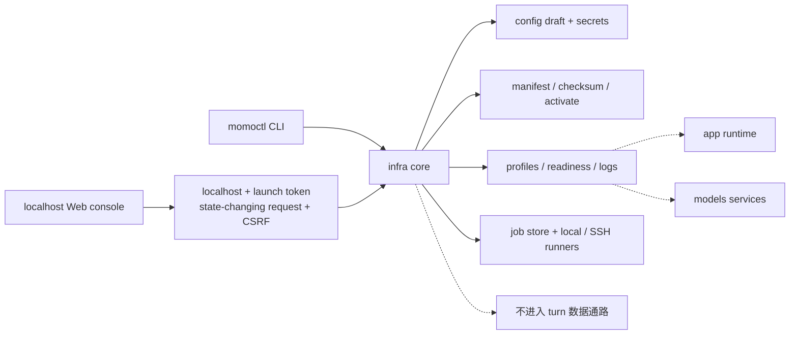
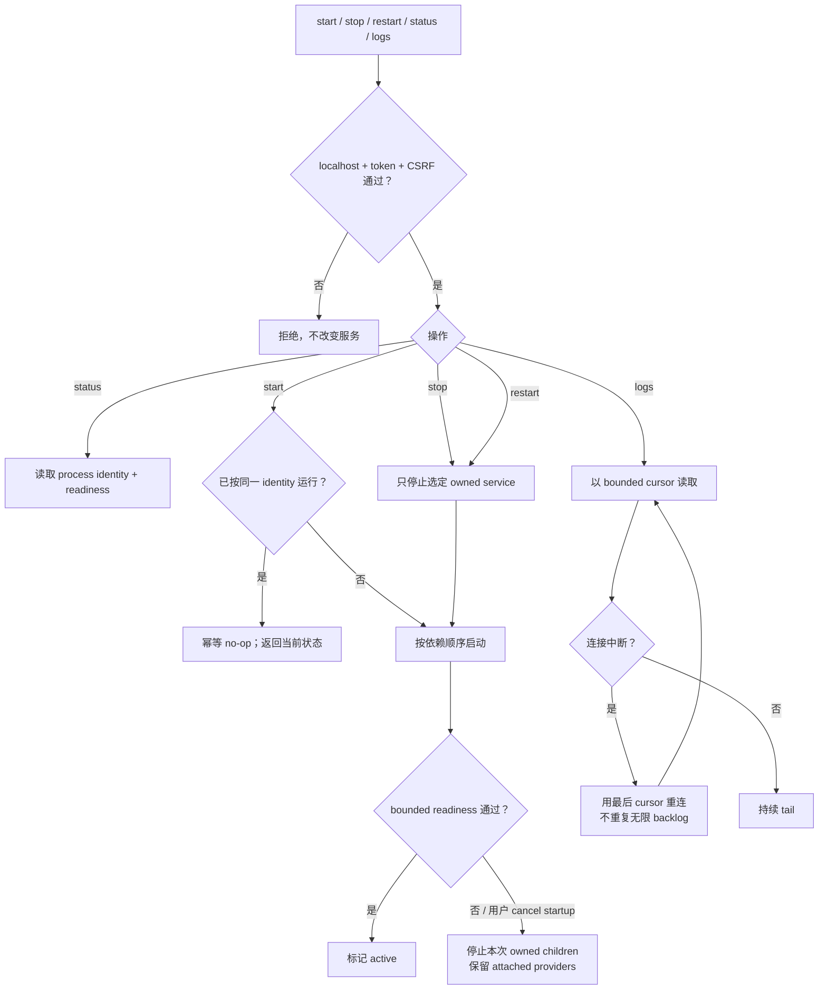
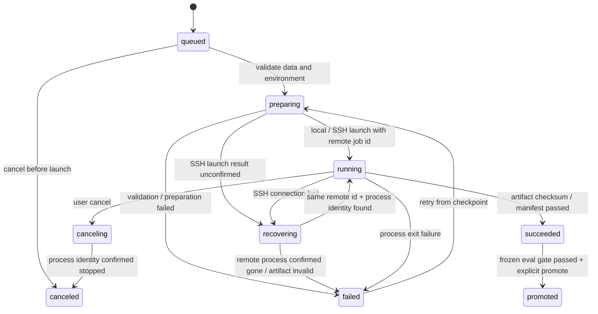

# `infra/`：带外运维与训练编排（momo-infra 仓的 infra 模块）

> `infra/` 与 `models/` 共同组成 **`momo-infra`**——自有 AI 基础设施（ADR-027/029）：训练 pipeline（LLM 后训练、ASR/TTS 全链路）+ 复用开源底座的 serving 能力 + 统一对外 gateway。当前 `momoctl` 承担基础运维，Web 控制台与训练可视化属扩展能力；不读取对话内容，不转发 turn 音频/文本，不实现推理引擎。

## 演进范围（momo-infra 终态）

| 域 | 内容 | 复用 / 自研 |
|---|---|---|
| 训练 | LLM 后训练、ASR/TTS 全训练 pipeline、frozen eval gate、promotion | 复用现有 job/pipeline 编排（本文档），训练实体脚本在 models/ |
| Serving | LLM 推理 serving | **复用 vLLM 等开源底座**，不手搓推理/KV cache |
| Gateway | 对内多模型容灾与负载均衡，对外单一 OpenAI-compatible 接口 | 自研（差异化价值所在） |
| ASR/TTS 服务 | 对外接口形态对齐主流云服务（REST/WS），app 可直接配置 | 自研服务封装 + models/ adapters |

## 能力

- doctor/readiness、normal/degraded profile 与服务启停；
- manifest fetch/checksum/probe/activate/rollback；
- 配置 draft validate/test/atomic apply/rollback，secret 独立保存；
- 训练 job 本地/SSH 执行、日志、cancel、checkpoint 恢复、promotion；
- CLI 与 Web 共用核心和 schema，控制台默认仅监听 localhost。

## 子命令清单

> `momoctl` 是 infra CLI 的唯一命令名（ADR-023）。本节是命令行契约的 single source of truth：`infra/src/cli.rs` 的 clap 定义与本节一一对应，退出码、全局 flag 与 `--json` schema 也以本节为准；`infra/README.md` 只保留摘要并指回本节。

子命令集（ADR-023 锁定命名，实现状态见下）：

| 子命令 | 说明 | 状态 |
|---|---|---|
| `doctor` | 环境检查矩阵（system/toolchain/python/network/env/models/endpoints） | 已实现 |
| `pull` | 按 momo-models `MANIFEST.toml` 下载 + sha256 校验 | 已实现 |
| `serve up\|down\|status\|logs\|restart` | profile 组件表启停、存活/就绪探测、日志 tail | 已实现 |
| `switch --to` | normal ↔ degraded 档位切换（`.env` 符号链接重指） | 已实现 |
| `bench` | 端到端延迟测量（p50/p95，目标 <1.5s 出声） | 已实现 |
| `gc` | 模型 GC：N-1 代清理、`models.lock` 联动 | 已实现 |
| `pipeline list\|run\|resume\|status` | 训练 pipeline 编排：`infra/pipelines/*.toml` 定义，串行 step + exec_local/exec_ssh + 断点续跑 + 产物登记 | 已实现 |
| `config check` | env schema 漂移检查（`config.schema.toml` ↔ 三侧 `.env.example` / `config.md`） | 已实现 |
| `web` | Web 控制台基座：axum server + include_dir 内嵌 SPA + `/api` 路由树 + SSE | 已实现 |
| `jobs submit\|list\|status\|log\|cancel\|recover` | job runner：exec_local + exec_ssh 执行器、状态机、日志 tail；store 落 state dir（`jobs exec` 为内部 helper） | 已实现 |
| `gateway` | 统一对外 gateway：`/v1/*` → llm 池（priority 分组 + 组内加权轮询 + 失败 failover/熔断）；`asr.paths`/`tts.paths` 透明反代（ASR WS upgrade 帧中继）；`/healthz` `/readyz` `/metrics` 本地自报告；架构与配置见 `docs/01-architecture/gateway.md` | 已实现 |

### 子命令参数

`serve` 五个动作共用 `ServeCommon`，`serve logs` 在此基础上追加行数/跟随参数：

| 子命令 | 参数 | 默认 | 说明 |
|---|---|---|---|
| `doctor` | `--profile normal\|degraded` | 读 `MOMO_PROFILE`，缺省 `normal` | 按档位校验必需 env 与端点 |
| `pull` | `--manifest PATH` | 自动探测 momo-models `models/MANIFEST.toml` | MANIFEST.toml 路径 |
| `pull` | `--only NAME`（可重复） | 全部条目 | 只处理指定清单条目 |
| `pull` | `--check` | off | 只校验不下载（按 `models.lock` / MANIFEST 复算 sha256） |
| `serve` | `--profile normal\|degraded` | 读 `MOMO_PROFILE`，缺省 `normal` | 组件清单档位 |
| `serve` | `--only COMPONENT`（别名 `--component`，可重复） | 全部组件 | 只作用于指定组件 |
| `serve` | `--app-bin PATH` | PATH 查找 | `momod` 二进制路径 |
| `serve logs` | `-n, --lines N` | `50` | 每个组件输出最后 N 行 |
| `serve logs` | `-f, --follow` | off | 持续跟随新增日志（Ctrl-C 退出） |
| `switch` | `--to normal\|degraded` | — | 目标档位 |
| `switch` | `--restart` | off | 切换后自动 `serve down && serve up` |
| `bench` | `--turns N` | `5` | 测量回合数（取 p50/p95） |
| `bench` | `--strict` | off | 超标（≥1.5s 出声）时以退出码 3 结束 |
| `gc` | `--dry-run` | 默认行为 | 只报告不删除 |
| `gc` | `--keep N` | `2` | 微调产物保留代数（N-1 中保留最新两代） |
| `gc` | `--yes` | off | 确认执行删除（不带 `--yes` 时等价 `--dry-run`） |
| `pipeline run` | `--name NAME` | — | pipeline 定义名（`infra/pipelines/<name>.toml`） |
| `pipeline run` | `--set KEY=VALUE`（可重复） | — | 注入定义 `[vars]` 变量；required 变量缺失 → exit 2 |
| `pipeline run` | `--dry-run` | off | 不执行命令不登记，只展开 step 计划与命令（状态不落盘） |
| `pipeline run` | `--date YYYYMMDD` | 当日 UTC | 产物代际日期（`{date}` 占位与 `ft-*-<yyyymmdd>` 命名） |
| `pipeline run` | `--manifest PATH` | 自动探测 momo-models `models/MANIFEST.toml` | register step 追加条目的清单 |
| `pipeline run/resume/status` | `--dir PATH` | 自动探测 `infra/pipelines/` | pipeline 定义目录 |
| `pipeline resume/status` | `--run-id ID` | 最近一个未完成 / 最新 run | 目标 run |
| `config check` | `--root PATH` | 从 CWD 向上定位 `config.schema.toml` | 仓库根目录 |
| `web` | `--listen ADDR` | `127.0.0.1:7900` | 监听地址；解析结果任一非 loopback 时 `MOMO_WEB_TOKEN` 必填，未设拒启（exit 2） |
| `jobs submit` | `--kind pull\|serve\|train` | `train` | job 来源域 |
| `jobs submit` | `--executor local\|ssh` | `local` | 执行器：本地子进程 / SSH 远端 |
| `jobs submit` | `--desc TEXT` | join(argv) | 可读描述 |
| `jobs submit` | `-- CMD [ARGS...]` | 必填 | payload 命令行；`--` 之后的参数全部按 argv 传递（ssh 时打包进 run.sh） |
| `jobs submit` | `--host HOST` | ssh 必填 | SSH 目标：`~/.ssh/config` Host 别名（`4090D`/`mac-studio`）或 hostname |
| `jobs submit` | `--user USER` | ssh config | 显式登录用户 |
| `jobs submit` | `--key PATH` | ssh config | 显式 identity 文件 |
| `jobs submit` | `--remote-dir PATH` | `~/.cache/momo/remote-jobs` | 远端工作根；job 目录为 `<remote-dir>/<id>` |
| `jobs submit` | `--env KEY[=VALUE]`（可重复） | 空 | env 白名单：裸 KEY 取本地 env；敏感键恒丢弃 |
| `jobs submit` | `--data PATH`（可重复） | 空 | 随 bundle 上行的数据文件/目录（落 `data/`） |
| `jobs submit` | `--artifact-name NAME` | 空 | 成功收尾时把远端 `artifacts/` 登记到 `${MOMO_MODELS_DIR}/NAME` |
| `jobs submit` | `--lease-hours H` | 空 | 远端机器租约时长（如 4090D 24）；换算释放时刻落盘 |
| `jobs status` | `ID` | 必填 | job id（ULID） |
| `jobs log` | `-n, --lines N` | `50` | 输出最后 N 行 |
| `jobs log` | `-f, --follow` | off | 跟随新增输出；job 进终态且日志排空后退出 |
| `jobs cancel` | `ID` | 必填 | 非终态 → canceling + SIGTERM→SIGKILL（本地 pid）/ 远端 TERM→KILL（ssh）；终态幂等 |
| `jobs recover` | `ID` | 必填 | recovering/未认领的 ssh job 重挂 runner（按 remote job id 重查，不重复 launch） |
| `gateway` | `--listen ADDR` | `MOMO_GATEWAY_LISTEN` > 配置 `listen` > `127.0.0.1:7830` | 监听地址 |
| `gateway` | `--config PATH` | `MOMO_GATEWAY_CONFIG` > `./gateway.toml` | gateway TOML 配置（`[[llm.backends]]`/`[[asr.upstream]]`/`[[tts.upstream]]`，样例 `infra/gateway.example.toml`） |

### 全局 flag

| flag | 说明 |
|---|---|
| `--json` | 以 JSON 输出单一对象（顶层恒带 `"schema": 1`，供 CI/脚本消费） |
| `--env-file PATH` | `.env` 文件路径（默认自动发现 `./.env`；显式指定但不存在 → exit 2） |

CLI 不提供 `-v/-vv`：日志级别由 `MOMO_LOG_LEVEL`（内置默认 `info`，见 [config.md §2.1](../01-architecture/config.md)）控制，`infra/.env.example` 里的 `warn` 是 schema `examples.infra` 的**模板示例值**，不是内置默认值。infra 当前不输出分级日志（详见 [config.md §6](../01-architecture/config.md) `examples` 字段口径）。

### 退出码

`infra/src/output.rs` 的 `ExitCode` 与之对应：

| code | 含义 |
|---|---|
| 0 | 成功（doctor 全 ok / bench 达标） |
| 1 | 运行时错误（IO、进程管理失败、未实现 stub） |
| 2 | 用法/配置错误（clap 解析之外：缺 env、env-file 不存在等） |
| 3 | 检查未通过（doctor 有 fail / bench --strict 超标） |
| 4 | 网络不可达（下载、端点连接失败） |
| 5 | 校验失败（sha256 不匹配、manifest 损坏） |

### doctor JSON schema

`tests/doctor_json_test.rs` 锁定 `momoctl doctor --json` 的结构：

```json
{
  "schema": 1,
  "profile": "normal",
  "groups": [
    { "name": "system", "checks": [
      { "id": "os", "status": "ok", "detail": "<os> <version> (<arch>)", "hint": null }
    ] }
  ],
  "summary": { "ok": 1, "warn": 0, "fail": 0 }
}
```

`status` ∈ `ok|warn|fail`；`hint` 恒出现（可为 `null`）；`groups` 固定含 system/toolchain/python/network/env/models/endpoints 七组。

### MANIFEST 下载源（`source` 字段）

`pull` 按清单条目 `source` 分发下载 URL，缺省 `hf`（无 `source` 字段的旧清单行为不变）：

| `source` | 下载 URL 口径 |
|---|---|
| `hf`（缺省） | `<HF_ENDPOINT>/<repo_id>/resolve/<revision>/<files[].path>` |
| `url` | 逐文件 GET `files[].url` 原文（仅 http/https），不经 `HF_ENDPOINT`；`repo_id`/`revision` 不参与拼接，仅作 `dest` 默认值与 `models.lock` 的 `repo@revision` 身份 |

- `source = "url"` 时每个 `files[]` 必须声明 `url`（GitHub raw、`media.githubusercontent.com`、其他镜像仓直链均可）；缺 `url` 或 scheme 非 http/https → MANIFEST 校验拒绝（exit 5）。
- `hf` 条目下单个 `files[].url` 是合法覆盖：存在即对该文件走直链，其余文件仍走 resolve 拼接。
- sha256/size 校验、`.part` + Range 续传、`models.lock` 登记口径与 hf 源完全一致。实例：`silero-vad` 条目上游仅 GitHub（HF 无 `snakers4/silero-vad`），以 `source = "url"` + `raw.githubusercontent.com` 直链下载（#148）。

## 控制面



## Web 控制台

`momoctl web` 起 axum server（tokio runtime，Ctrl-C 优雅退出），默认监听 `127.0.0.1:7900`：

- **启动守卫**：`--listen` 的解析结果任一非 loopback（`to_socket_addrs`，`localhost` 需全部回环）且 `MOMO_WEB_TOKEN` 未设 → 拒启，exit 2。
- **请求级认证链**（`require_auth` 中间件，layer 到 `/api` 子树；SPA 不经认证层）：
  - **token**：`MOMO_WEB_TOKEN` 已设 → `/api` 全请求（含 loopback）须 `Authorization: Bearer <token>`，缺失/不匹配 → 401；未设 → 仅 loopback peer 且 Host 回环放行（Host 检查防 DNS rebinding），否则 403。token 比对常量时间；token 值不落日志不回显（config.md §4）。
  - **CSRF**：state-changing 方法（非 GET/HEAD/OPTIONS；SSE 走 GET 属只读）须以 `X-CSRF-Token` 头回带 `GET /api/csrf` 签发的进程级 token（每启动重签发），且 `Origin`（若携带）authority 须等于 `Host`；缺失/不匹配 → 403。`/api/csrf` 响应不加 CORS 允许头，跨源页面读不到 token（SOP）。
  - 认证失败与路由错误统一 `{schema:1, error:{code,message}}`（`code` ∈ `unauthorized`/`forbidden`/`csrf`/`not_found`/`not_implemented` 等）。
- **`/api` 路由树**：集中注册。`GET /api/` 路由索引；`GET /api/healthz` / `readyz`（server 自身探针）；`GET /api/events` SSE 通道（broadcast 基座，jobs/serve 日志复用）；`GET /api/csrf` CSRF token 签发；`GET /api/doctor`（`doctor` 检查矩阵）、`GET /api/serve/status`（组件快照）、`GET /api/serve/components`（内置 profile 组件表，order 升序 + external/local_endpoint_only 标记）——复用 cmds 同名 core 函数，`?profile=normal|degraded` 可选（缺省读 `MOMO_PROFILE`），检查有 fail 仍 200（fail 是数据非 HTTP 错误，对应 CLI exit 3 语义），其余方法 → 405；`POST /api/serve/{up|down|restart}`（body `{only:[..]?}`，与 `momoctl serve` 同 inner core，`only` 未命中组件 → 400）为 state-changing 端点，须 CSRF；`GET /api/serve/logs/{name}/stream` 为 SSE 日志 tail（`id:` 帧号 = 字节 offset，断线以 `?cursor=` 或 `Last-Event-ID` 续传，无 cursor 时只发有界 backlog）；`/api/jobs` 已挂真实 handler（见「jobs runner 与 store」）；`GET /api/pipelines` 下发 `infra/pipelines/*.toml` 定义清单（含 `[vars]` 与 `activate_env`，训练页 wizard 表单数据源，与 `pipeline list --json` 同 DTO；目录未找到 → 200 空清单）；`models`/`config`/`pipelines` 其余路由为 501 占位，由各功能 issue 挂 handler。`/api` 子树内未命中 → JSON 404。
- **训练页（SPA 路由 `/train`，issue #42）**：四块联动——pipeline wizard（`GET /api/pipelines` → 选定义/执行器/填 vars → 预览展开的 `pipeline run` 命令 → `POST /api/jobs {kind:"train", pipeline, set, dry_run?, executor?}` 快捷提交，服务端把 pipeline 展开为 `<momoctl> pipeline run --name <p> --set k=v ...` argv；`executor` 缺省 `local`，`ssh:*` 等远端执行器属 #51，当前 422 字段级拒绝）、job 列表（`GET /api/jobs` 轮询）、job 详情（`GET /api/jobs/{id}/logs` SSE tail + `GET /api/jobs/{id}/metrics` 的 train-manifest.json → loss 曲线 sparkline）、promote（`POST /api/jobs/{id}/promote`，语义见「jobs runner 与 store」REST 表）。
- **配置页（`/api/config`，对应 SPA 路由 `/config`）**：编辑对象为 `.env` 同目录的 `.env.<profile>`（与 `switch` 生成口径一致；`.env` 定位 = `--env-file` > dotenvy > `./.env`，profile 白名单 `normal|degraded`，无路径穿越面）。
  - `GET /api/config[?profile=]` → `{profile, active_profile, env_file, file_exists, entries:[{key, value, sensitive, set}]}`；`?profile=` 缺省按 `active_profile` 状态文件 > `MOMO_PROFILE` > `normal` 解析。**敏感键（schema `sensitive` ∪ `*_API_KEY/*_TOKEN/*_SECRET`）只回打码值（前 4 位 + `…`，短值全遮）或 `set/unset`，GET/日志/diff 绝不回显明文**（config.md §4）；schema 键序在前，文件内 schema 外键（passthrough/游离键）列尾只读展示。
  - `PUT /api/config {profile?, changes:{key:value}}`：先校验——非 `MOMO_` 前缀、schema 未知键、值域越界（enum/bool/int/url）→ **422 `error.fields` 字段级归因，不写盘**；通过 → copy `.env.<profile>` 为 `.env.<profile>.bak` → 同目录 tmp + `rename` 原子替换（保行尾注释/键序，未命中键追加尾部）→ 返回掩码 diff + `restart_hint`（env 变更经 `serve restart` 生效）；任何一步失败 active 不变。目标文件缺失 → 404（先 `momoctl switch --to <profile>` 生成）。敏感键留空不进 `changes` 即不变更。
  - `POST /api/config/rollback {profile?}`：从 `.env.<profile>.bak` 原子恢复（bak 保留），返回掩码 diff；无 `.bak` → 404。
  - `GET /api/config/schema` → `{schema:1, keys:[{name, type, default, values?, sensitive, description, component}]}`：`config.schema.toml` 单源直出（服务端不维护第二份键表），`type` 对外口径 `str|int|bool|enum|url|path`（schema 文件的 `string` 在 API 边界映射为 `str`），`component` ∈ `common|app|models|infra` 对齐 config.md §2.1–2.4。SPA 据此渲染控件与分组（enum→select、bool→switch、int→number、敏感键掩码控件、未知 type 只读降级），前端不内置键表——schema 增删键下次拉取即生效；前后端双重校验同一值域。
  - 写操作走同一认证链：Bearer（token 模式）+ `X-CSRF-Token` + Origin 一致。
- **DTO 契约**：REST 出入参与 `momoctl --json` 共用 `infra/src/api/dto.rs` 一套 serde 类型（`DoctorReport`/`ServeReport`/`Check`/`Summary` 等），handler 只做「解参 → 调同一 core 函数 → 包 DTO」，不手写 `json!`；JSON 顶层恒 `schema:1`；错误统一 `{schema:1, error:{code,message}}`。`tests/api_contract_test.rs` 对同一操作两侧对跑（tower `oneshot` 免端口），锁定字段名/类型/必选性，防 CLI/Web 漂移（验收：「CLI/Web 对同一操作给出同一 schema 与状态」）。- **SPA**：`include_dir!` 编译期内嵌 `infra/web/`（无部署目录依赖）；命中按扩展名给 content-type，未命中回退 `index.html`（前端路由），与 `/api` 404 分流不误判。
- **输出**：启动打印监听地址与 token 提示（值不落日志）；`--json` 输出 `{schema:1, command:"web", listen, url}`。

## service 操作



## 状态目录与进程管理

`serve` 的运行态落在固定状态目录，内容是本机临时产物（pidfile、组件日志、active 标记），不是部署配置：

- 路径：`${XDG_STATE_HOME:-~/.local/state}/momo/`，下含 `pid/<component>.pid`、`logs/<component>.log`、`active_profile`。
- 可配性：不提供 `MOMO_*` env 键覆盖，`XDG_STATE_HOME` 是唯一重指手段（测试隔离也走它）。固定路径消掉 profile/env 漂移面——状态目录漂移会让 `down`/`status` 读不到 `up` 写的 pidfile，幂等判定失效。
- 各平台落点：`~` 按 `env_cfg` home 候选解析——unix `$HOME`；Windows `%USERPROFILE%`（`HOME` 兜底，全空退 `.`），即 `%USERPROFILE%\.local\state\momo`。早期方案曾定 `%LOCALAPPDATA%/momo`（#44③），后收口为全平台统一 XDG 默认形、未实装 LOCALAPPDATA 特判。

进程探活与终止不依赖 PATH 上的外部命令（原 `kill`/`ps`/`tasklist` 外部依赖已移除；Windows 的 `taskkill` 只做温和请求/树杀兜底，缺失不阻塞升级）：

- 进程组隔离：`serve` spawn 组件时 unix 用 `process_group(0)` 让 child 自成进程组（pgid == child pid，pidfile 记录的 pid 即组 id，无需另记）；windows 不做 spawn 前置/后置挂接，改在终止/探活时按 Toolhelp32 快照沿 `th32ParentProcessID` 追溯全部后代（孤儿子进程的父 pid 字段仍指向已死 wrapper，BFS 即收；曾试过具名 Job Object 方案，嵌套 Job 下孙进程未继承成员资格，不可靠）。`uv run` 这类 wrapper 的孙进程（python 服务本体）随之与 wrapper 同生共死——wrapper pid 死掉后残留孙进程仍能被收掉（#149：曾 abort/down 只杀 wrapper，孙进程持端口致下次 up 撞端口再起失败）。
- 存活探测 `is_alive`（单 pid，jobs runner 用）：unix 先 `waitpid(WNOHANG)` 收本进程 child 的尸（替代 `ps stat` 排僵尸），非本进程 child 落 `kill(pid, 0)`——送达或 `EPERM`（存在但属其他用户）判活，`ESRCH` 等判死；Windows `OpenProcess(PROCESS_QUERY_LIMITED_INFORMATION)`——打不开且 `ERROR_ACCESS_DENIED` 判活、其余判死，打开后 `GetExitCodeProcess` 判 `STILL_ACTIVE`，查询失败保守判活（宁 down 不收敛，勿 up 重复拉起）。
- 组件存活 `component_alive`（serve 用）：`is_alive(pid)` 之外补查组关系——unix `kill(-pid, 0)` 进程组仍有成员、windows 后代表非空即判活。wrapper 死后孙进程残留不再被当成 stale pidfile：`status` 报 warn（pid exited but process group still active），`down`/`up` 据此收孤儿。
- 终止阶梯 `stop_component`（serve 用）：unix 对 `pid` 与进程组 `-pid` 同发 `SIGTERM` → grace 轮询组关系存活 → `SIGKILL`；Windows 温和/强杀两段都走 `taskkill /T` 收活树 + Toolhelp 后代表逐个终止 + `TerminateProcess` 兜底（孤儿分支父链已断，靠 ppid 归因）。pid 本体已死只剩孤儿时跳过温和段直接强杀。`serve up` 的 abort 清理走 `kill_component` 整组/整树强杀；单 pid 阶梯 `stop_pid` 保留给 jobs runner。

## 训练 lifecycle 与恢复



重连按 remote job id 与 process identity 查询；未确认前绝不重复 launch。`canceled` 是独立终态，不写成 failed。rollback 只切回 active artifact version，不修改原 job 的 `succeeded` / `promoted` 历史状态。恢复沿用已有 checkpoint 与 training manifest，不新增训练配置或评分门槛。

## jobs runner 与 store

通用 job runner（`infra/src/jobs/`）：`queued → preparing → running → succeeded/failed`，`canceling → canceled` 独立终态，`recovering` 归 exec_ssh 断线重查；`succeeded → promoted` 由 `POST /api/jobs/{id}/promote` 实装（#42）：gate 证据（关联 run succeeded / `train-manifest.json` 在盘）+ 显式请求 → `activate_env` 写回 `.env.<active>`（`.bak` + 原子写，rollback 保留）→ 状态迁移；`failed → preparing` retry 留给后续 issue（枚举保留取值，store/API 可反序列化）。执行器由 `JobRecord.executor`（`local`/`ssh`）区分，`jobs exec` helper 按它分发。

**store 布局**：复用状态目录 `${XDG_STATE_HOME:-~/.local/state}/momo/jobs/`（不提供 `MOMO_*` 覆盖键，口径同 pidfile）：

- `jobs.jsonl`：每次状态迁移 append 一行 `{id, kind, status, ts, detail?}` 并 fsync——索引是迁移的权威记录，重建时按序回放取最后态；
- `meta/<id>.json`：`JobRecord` 全量（`id/kind/desc/args/executor/ssh?/status/created_at/updated_at/remote_id?/pid?/runner_pid?/log_path/exit?/error?/cancel_requested?`），tmp+rename 原子写；`ssh` 子对象存远端规格（`host/user?/key?/remote_dir/env_keys/artifact_name?/release_ms?`）；
- `logs/<id>.log`：payload stdout/stderr 合流追加，log cursor=字节偏移。runner 诊断行以 `[runner]` 前缀写同一文件；
- `bundles/<id>/`：exec_ssh 暂存——`payload/` 是推上远端的 bundle（`run.sh`/`env.sh`/`data/`），同级放拉回暂存（`remote-run.log`、`pull.offset`、`ckpt/`、`artifacts-prefetch/`），不随 rsync 上行。

迁移写入顺序固定「先索引后 meta」：crash 只丢 meta 新版本，rescan 以索引最后态回补；反过来会把已生效迁移回滚成旧态。

**exec_local**：`jobs submit`（或 `POST /api/jobs`）建档后 spawn detached helper `momoctl jobs exec <ID>`（内部命令，CLI 不可见）。helper 是状态机的唯一写入方：写 `runner_pid` 认领 → `preparing` → spawn payload 记 `pid`（process identity）→ `running` → stdout/stderr 增量并入 `logs/<id>.log` → 按 exit code 落 `succeeded`/`failed`；cancel 请求（`canceling`）由 helper 的 wait 返回或 cancel 命令自身收尾到 `canceled`。主进程退出后 helper 继续跑，CLI 与 Web 读写同一 store 无内存共享；非 queued 状态下 exec 是 no-op，绝不重复 launch。Windows 上 spawn helper 前先清本进程三个标准句柄的 `HANDLE_FLAG_INHERIT`——否则常驻 helper 会继承调用方的 pipe 写端（CI step、shell 管道、`Command::output()`），调用方 read 永远等不到 EOF；helper 自身 stdin/stdout/stderr 由显式重定向提供，不受影响。

**exec_ssh**（`jobs/ssh.rs`，issue #51）：`jobs submit --executor ssh --host <alias>` 走远端执行，helper 仍是状态机唯一写入方，远端不跑任何 momo 组件：

1. **bundle staging**：submit 把 `bundles/<id>/payload/` 写好——`run.sh`（监督脚本：记 `job.pid`/`payload.pid`，起 payload，`wait` 后写 `exit.code`）、`env.sh`（env 白名单 `export` 行）、`data/`（`--data` 附带文件）。**env 白名单按名过滤**：`*_API_KEY`、含 `_TOKEN`/`_SECRET`/`_PASSWORD`/`_CREDENTIAL`/`_PRIVATE_KEY` 的键一律丢弃并 warn，绝不推上借来的机器（borrowed-etiquette.md）；meta 只记键名 `env_keys`，值只进 bundle 不进 store/API。
2. **push + launch**：helper `rsync -az` 推 bundle 到 `<remote_dir>/<id>`（host/user/key 全部交给 `~/.ssh/config` 与 job 字段，ssh 走 `BatchMode`+`ConnectTimeout`），再 `ssh 'nohup sh <dir>/run.sh > run.log 2>&1 </dev/null & echo $!'` 远端 detached launch，回读的远端 pid 记 `remote_id` → `running`。
3. **周期拉回**：helper 每轮 probe + 增量 rsync 拉回 `run.log` 追加进 `logs/<id>.log`（CLI `jobs log` 与 SSE `/api/jobs/{id}/logs` 同文件，日志路径与本地 job 完全一致）；`ckpt/` 按周期（默认 5min）增量拉回 `bundles/<id>/ckpt/` 本地快照。
4. **process identity**：`kill -0 <pid>` + `ps -o args= -p <pid>` 须含 `<remote_dir>/run.sh` 标记——pid 被复用时 args 不含 job 目录即判消亡；`remote_id` 缺失时 `pgrep -f <dir>/run.sh` 找回 pid。
5. **收口**：probe 确认进程消亡（链路必须通）→ 终拉日志/ckpt → 读 `exit.code`：0 且给了 `--artifact-name` → rsync 拉 `artifacts/` 到 `${MOMO_MODELS_DIR}/<name>`，逐文件 sha256+size 写 `models.lock`（`local/<name>@<job_id>` 条目，train-manifest.json 随产物同行）→ `succeeded`；非零 → `failed`；无 exit.code → `failed("remote process exited without status")`。
6. **断线 recovering**：链路失败（ssh 255/超时）→ `recovering`，按 `recover_poll` 持续重查；确认同一进程存活 → `running` 续传；确认消亡才收口；**未确认前绝不重复 launch**（launch 回复丢失同样进 `recovering`，由 `pgrep` 标记找回）。helper 死亡时 reconcile 把 ssh job 收口为 `recovering`，`jobs recover <ID>`（或 `POST /api/jobs/{id}/recover`）重挂 helper 恢复监控——recovering job 的 cancel 只落 `cancel_requested` 标记，helper 重连后补刀收口 `canceled`。
7. **4090D 纪律**（borrowed-etiquette.md）：`--lease-hours` 换算释放时刻 `release_ms` 落盘；距释放不足 1h 时把远端 `artifacts/` 预拉快照到 `bundles/<id>/artifacts-prefetch/`（机器被回收前产物已攥在手里，收口时远端拉不到则回退用快照登记）；checkpoint 每 2h 落盘是训练脚本自身纪律，runner 只做周期拉回。

传输抽象在 `Transport` trait（`push/pull/launch/probe/find/read/stop`）：生产走 `SystemTransport`（ssh/rsync 外部命令），单测注入 fake（本地沙盒目录模拟远端 FS + 真 spawn `sh run.sh`），不需要真实远端。Windows 无可靠 OpenSSH+rsync 组合，`--executor ssh` 直接报 unsupported（exit 2）。

**rescan（重启恢复）**：`momoctl web` 对外接 API 前、以及 CLI/Web 每次读侧入口（list/status/log/cancel/recover）先跑 `store.reconcile()`：回放 `jobs.jsonl`（坏行跳过 warn）对齐落后 meta（终态不反转），再按 process identity 收口非终态 job——`runner_pid` 活着说明迁移仍由 runner 负责（`recovering` 回 `running`）；runner 死亡则探 payload `pid`：确认存活 → `running`（adopt，不重复 launch）；确认消亡 → `failed("interrupted: runner restart")`（`canceling` 中 → `canceled`）；无法确认（`remote_id` 的 SSH job 或 pid 缺失）→ `recovering`，由 `jobs recover` 重挂 exec_ssh helper 接管；`queued/preparing` 未被认领超 60s 宽限 → `failed("interrupted: runner never claimed the job")`。每条修正 append 索引 + fsync，与 runner 写路径同构。

**REST**（`/api/jobs`，JSON 顶层恒 `schema:1`）：

| 端点 | 说明 |
|---|---|
| `GET /api/jobs` | 全量列表（created_at 升序） |
| `POST /api/jobs` | 提交：`{kind?, executor?, ssh?, desc?, args:[argv...]}`，同 `jobs submit`；`executor:"ssh"` 时 `ssh:{host,user?,key?,remote_dir?,env?,data?,artifact_name?,lease_hours?}` 必填（env 的 null value = 取 server 进程 env）。或 `{kind?, pipeline, set?, dry_run?}` 快捷提交——服务端展开为 `<momoctl> pipeline run --name <p> [--dry-run] --set k=v ...` argv（与 `args` 互斥；required var 缺项 → 422 `error.fields` 逐字段归因；pipeline 形态只走 local 执行器——pipeline step 自行管理 ssh 目标） |
| `GET /api/jobs/{id}` | 单条 record；未知 id → JSON 404 |
| `POST /api/jobs/{id}/cancel` | 同 `jobs cancel`；终态幂等；recovering ssh job 只记 `cancel_requested` |
| `POST /api/jobs/{id}/recover` | 同 `jobs recover`；非 ssh job → 400 |
| `POST /api/jobs/{id}/promote {env_key?, artifact_dir?}` | `succeeded` → `promoted`（终态幂等）。产物解析：显式 `artifact_dir` > 关联 pipeline run 的 `artifact_dir`（run_id ULID ≥ job id 的最小 run）；run 存在但非 succeeded → 409；产物目录缺 `train-manifest.json`（frozen gate 证据）→ 409。激活：`env_key` > pipeline `activate_env` 键写回 `.env.<active>`（schema 值域校验 + `.bak` 备份 + tmp/rename 原子替换——rollback 目标即 `.bak`/config 页 rollback）；pipeline 未声明激活键时只迁移状态并在 note 说明。env 文件缺失 → 409 |
| `GET /api/jobs/{id}/metrics` | loss 曲线数据源：`{run_id, artifact_dir, manifest, steps[{name,status,metrics}]}`——关联 pipeline run 的 step metrics + `<artifact_dir>/train-manifest.json` 原文；非 pipeline job 兜底查 `logs/` 旁 manifest；无关联 → 字段为 null（200，「无曲线」是数据不是错误） |
| `GET /api/jobs/{id}/logs?cursor=N` | SSE tail：`event: log` 携 `{cursor, chunk}`，`id:` 帧 = 消费后字节 offset（同 `serve logs/{name}/stream` 约定，断线 `?cursor=`/`Last-Event-ID` 续传）；终态排空后 `event: end` 关流；cursor 越界（截断）从 0 重读 |
## 训练 pipeline 编排（`momoctl pipeline`）

`infra/pipelines/*.toml` 声明 pipeline，infra 只做编排不实现训练/推理（ADR-025）：step 只编排名称、执行方式、命令、产物路径与重试策略，训练实体仍调 momo-models `training/`、`eval/` 脚本。内置两条定义：`voice-sft`（prepare → upload → `sft_cosyvoice3`（ssh）→ rsync 回传 → frozen gate 盲听 → register）与 `persona-qlora`（build → regression-20 基线 → upload → `lora_qwen`（ssh）→ 回传 → frozen gate 回归 ≥34 且无 0 分 → register）。

定义 schema：

```toml
name = "voice-sft"
description = "..."
artifact_dir = "tts/ft-cosyvoice3-{date}"   # 相对 ${MOMO_MODELS_DIR}，register step 落点
activate_env = "MOMO_TTS_MODEL_DIR"         # 可选；promote 时写回 `.env.<profile>` 的激活键（.bak 即回滚目标）

[vars.input]
description = "raw voice material directory (10-60min clean speech)"
required = true                              # 由 `pipeline run --set input=...` 注入，缺失 exit 2

[vars.train_host]
default = "bigstrong"                        # 训练机 ssh alias（4090D）

[[step]]
name = "sft-cosyvoice3"
exec = "ssh"                                 # local | ssh | register
ssh_host = "{var:train_host}"                # exec=ssh 必填
workdir = "{var:remote_root}/models"         # local：相对 repo 根；ssh：远端路径字面量
command = "uv run python training/voice/sft_cosyvoice3.py ..."
artifact = "{artifact_dir}"                  # 可选；per-step manifest 记录 + metrics.json 拾取
retries = 1                                  # 失败额外重试次数（默认 0）
```

命令支持占位符：`{date}`（run 日 yyyymmdd）、`{run_id}`、`{run_dir}`、`{models_dir}`、`{artifact_dir}`/`{artifact_rel}`、`{repo_root}`、`{var:NAME}`；`$ENV` 展开交给 shell（ssh 侧在远端展开）。`exec=ssh` 经 `ssh <host> bash -lc '<cd workdir && command>'` 非交互派发（stdout/stderr 落 `logs/<step>-attempt<N>.log`）。

执行模型：step 严格串行；run 状态落在 `${XDG_STATE_HOME:-~/.local/state}/momo/pipeline-runs/<pipeline>/<run_id>/`（run_id 为 ULID，字典序即时间序），`run.json` 聚合全量状态，每步另写 `steps/<step>.json`——per-step artifact manifest 含 step、artifact 路径、metrics（自动拾取 `<artifact>/metrics.json`，register 步写入 files/bytes/登记名）、起止时间戳，tmp+rename 原子落盘。`resume` 跳过 `succeeded` step、从首个 failed/pending step 续跑（中途崩溃留 `running` 态按 failed 重跑）；`status` 输出 run 表（`--json` 同 DTO）。step 失败 → run `failed`、exit 1；run not found → exit 2。

`register` 是内建 step 类型（无 command）：要求 `{artifact_dir}/train-manifest.json` 已存在（训练脚本产出，含基座 revision、数据量、lr/steps/loss，缺失字段记 metrics.warnings 不硬拦）；递归复算产物文件 size+sha256 → 追加 `[[model]]` 条目（`name=ft-<engine>-<date>`、`repo_id=dest`、`revision=<date>`、`[[model.files]]` 全量 hash，`pull --check` 口径一致）+ upsert `models.lock`（`repo = "<dest>@<date>"`，同 `pull` 写入格式）。激活不改 env——按 voice-clone.md「只改 env」灰度，`MOMO_TTS_MODEL_DIR` 指向新目录即 promote，旧目录在 lock/gc N-1 代内天然是 rollback 目标。

评测骨架随定义落盘：`evals/persona/regression-20.yaml`（momo 仓 persona.md 六类 20 题、0/1/2 三档 ≥34 且无 0 分）与 `evals/voice/testset-15.yaml`（voice-clone.md 15 句覆盖 + 3 段固定参考音占位）。
## 模型激活

fetch 写临时目录 → checksum/revision 校验 → provider warmup/probe → 原子 activate。任一步失败保留 active 版本；promotion 后至少保留可回滚版本。详见 [model-fetch.md](../04-ops/model-fetch.md)。

## 验收

- [ ] CLI/Web 对同一操作给出同一 schema 与状态。
- [ ] 配置或模型 probe 失败时 active 不变。
- [ ] secret 不出现在 GET、日志、导出和静态网站。
- [ ] queued/preparing/canceling/recovering 路径不会报告假成功或重复启动。
- [ ] runtime 音频与对话文本不经过 infra。
