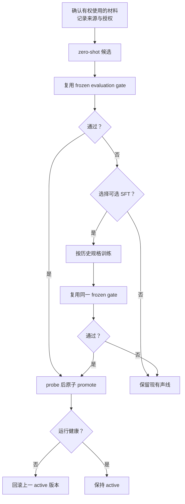
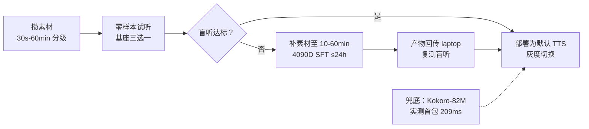
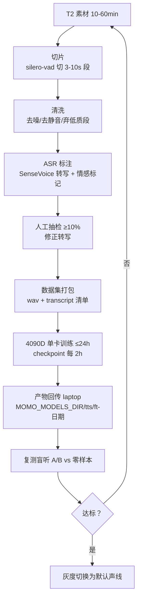

# 声线个性化

> 先用现成语音服务，逐步形成有授权、可替换的个人声线。

当前路径只接受有权使用的材料；先试 zero-shot，未通过 frozen gate 时再选择是否 SFT。任何新版本都先 probe、再原子 promote，并保留 rollback 目标。



<details>
<summary>历史实验规格与复现记录</summary>

> 目标：momo 拥有一条稳定、低延迟、有辨识度的克隆声线。
> 优先级：高。素材收集与零样本试听不依赖任何代码里程碑，**本周即可开始**。
> 部署位置与拓扑见 momo 仓 [system.md](https://github.com/Momoyeyu/momo/blob/master/docs/01-architecture/system.md)；本文只覆盖声线轨道本身。

## 路线



- 早期过渡：edge-tts（实测 2026-10-10 首包 1937ms，仅验证管线）。
- 本地 TTS 上线后：先 Kokoro-82M 兜底（实测首包 209ms / RTF 0.023 / VRAM 0.76GB），零样本克隆选定后替换。
- 零样本不达标时走 SFT；F5-TTS 零样本已实测跑通（RTF 0.535 / VRAM 0.8GB），作为克隆质量下限参照。

## 参考音频素材规范

素材分级（按可用总量）：

| 级别 | 时长 | 用途 | 说明 |
|---|---|---|---|
| T0 | 30s-2min | 零样本试听下限 | 只够跑 zero-shot，挑最干净的单段 |
| T1 | 2-10min | 优选零样本 / few-shot | 可切多段轮换参考音，评估更稳 |
| T2 | 10-60min | SFT 级 | 满足 GPT-SoVITS / Fun-CosyVoice3 微调素材量 |

质量要求（每一级都必须满足）：

- **单人声**：只有一个说话人；切片阶段再按说话人过滤一次。
- **无 BGM、无音效、低底噪、低混响**：录音室/安静房间直录最佳；带背景乐的素材直接弃用，不做分离补救。
- **格式**：WAV / FLAC，单声道，16-bit；采样率 ≥24kHz，建议 44.1kHz 或 48kHz（训练前统一重采样到目标基座要求的采样率）。
- **响度**：约 -20 ~ -16 LUFS，避免爆音与过度压限。
- **覆盖**：尽量覆盖目标语言的音素与常用情感（平静/开心/抱怨至少三类语气）。

授权合法性（硬性要求）：

- 只克隆**有权使用的声音**：本人声线、获得书面授权的声音、或许可证明确允许二次创作的公开声库。
- 自用阶段风险可控，但**直播/公开内容前必须确认声线授权链**，未经授权克隆真人声音不得上线。
- 素材来源与授权情况写入 `voice-materials/manifest.md`（本地保存，不入库原始音频）。

## 候选基座对比（零样本）

下列均为**官方标称**数据；落地性能以本机实测为准，VRAM 一律**待实测**（laptop 为 RTX 3070 Laptop 8GB）。

| 维度 | Fun-CosyVoice3-0.5B（首选） | GPT-SoVITS（备选） | IndexTTS-2（评估项） |
|---|---|---|---|
| 语言覆盖 | 官方标称 9 语言，含中/日/英 | 官方标称 中/英/日/韩/粤 | 官方标称 中/英为主 |
| 流式 | 官方标称双向流式，首包 150ms | 官方标称 4060Ti 上 RTF 0.028，支持分块输出 | 流式能力待实测 |
| 情感控制 | instruct 文本指令控制情感 | 参考音情感迁移 + 文本控制 | 官方标称情感向量/描述控制，表现力强 |
| 显存 | 待实测 | 待实测 | 待实测 |
| 许可 | Apache-2.0（以发布页为准） | MIT | Apache-2.0 |
| 训练/微调 | 有官方训练脚本 | 社区生态最成熟，微调工具链全 | 有开源代码，训练链待评估 |
| 依赖风险 | pynini 在 py3.12/WSL 有坑（见风险节） | 相对平滑 | 待评估 |

选择原则：**质量优先**（盲听说话），在质量可接受并列时按「流式 > 情感控制 > 依赖风险 > 训练支持」排序。推荐项固定为 Fun-CosyVoice3-0.5B，备选 GPT-SoVITS；IndexTTS-2 仅在盲听中明显胜出时转正。

## 零样本评估流程

1. **固定参考音**：从 T1 素材中选出 3 段（平静/开心/抱怨各一），全程不换。
2. **固定测试句集**：15 句，覆盖——中文日常 ×4、情感句 ×2、英文 ×2、日文 ×2、code-switch 混句 ×2、长难句/数字 ×2、疑问句 ×1。
3. **推理**：每基座 × 每参考音 × 每测试句生成音频，记录参数（temperature、采样率、ref 文本）到 `evals/voice/<date>/params.json`。
4. **盲听 A/B**（见下节）后定基座；参数记录归档，保证可复现。

## 盲听 A/B 评估表设计

评估协议：

- 评估人 ≥2 人；样本乱序、去掉引擎标签（文件名 hash 化）；同一测试句的不同引擎样本连续播放。
- 每样本按 4 个维度打 1-5 分（5 最好）：

| 维度 | 评什么 |
|---|---|
| 相似度 | 像不像目标声线（最重要，权重 ×2） |
| 自然度 | 韵律、断句、是否机器腔 |
| 情感 | 语气是否符合文本情感 |
| 稳定性 | 有无破音、漏字、跳字 |

- 汇总表（每引擎一行）：`加权分 = (相似度×2 + 自然度 + 情感 + 稳定性) / 5`，达标线 **≥3.5 且无任一测试句 ≤2**。
- 表格模板：

| 样本 ID | 引擎(盲) | 相似度 | 自然度 | 情感 | 稳定性 | 备注 |
|---|---|---|---|---|---|---|
| s01 | ? | | | | | |

评估产物存 `evals/voice/<date>/`，含打分表 csv 与结论 `result.md`（选谁、为什么、遗留问题）。

## 不达标时的 SFT 流程



关键环节要求：

- **切片**：silero-vad 切 3-10s 段；丢弃 <3s、>10s、含 BGM/爆音的段；保留说话人一致性（单素材源天然单说话人）。
- **标注**：SenseVoice-Small 转写（已实测 CPU RTF 0.040，2026-10-10），附带自动情感/事件标记；人工抽检 ≥10% 修正错字与标记。
- **训练**：4090D 24GB 单卡，单次会话 24h 硬上限（见 [../04-ops/borrowed-etiquette.md](../04-ops/borrowed-etiquette.md)）。checkpoint 每 2h 落盘且可断点续训；训练超参记录在 `train-manifest.json`（基座版本、数据量、lr、steps、loss 曲线）。
- **回传**：会话结束前**预留 ≥1h** 用 rsync/scp 把 checkpoint + manifest 拉回 laptop，路径 `${MOMO_MODELS_DIR}/tts/ft-<engine>-<yyyymmdd>/`；机器释放后再拉等于丢产物。

## 回传部署与灰度切换

声线版本切换 = **只改 env，不改代码**：

```env
MOMO_TTS_PROVIDER=cosyvoice3          # 备选 sovits / kokoro / f5 / edge
MOMO_TTS_MODEL_DIR=${MOMO_MODELS_DIR}/tts/ft-cosyvoice3-20261101
MOMO_TTS_VOICE_REF=${MOMO_MODELS_DIR}/voice/ref/ref_calm.wav
```

灰度步骤：

1. TTS 服务加载新产物，`/healthz` 通过后跑 15 句测试集合成试听。
2. 盲听复测（新 SFT 声线 vs 当前线上声线）达标 → 切默认。
3. 保留上一版本目录至少一个版本（N-1），回滚 = env 指回旧目录重启 TTS 服务。

## 风险与对策

| 风险 | 状态 | 对策 |
|---|---|---|
| MeloTTS 装不了（fugashi 需系统 MeCab，laptop 无 sudo） | **已否决，不再考虑** | 候选表里不再出现 |
| pynini 依赖坑（CosyVoice 系列在 py3.12/WSL 可能要折腾） | 已知 | 预留降级：Kokoro 已实测兜底；必要时隔离 venv/conda 或改用 GPT-SoVITS |
| torch/torchaudio 版本必须对齐 | 已踩坑 | 训练与推理镜像/锁文件统一 |
| 克隆声线版权 | 开放 | 直播前必须确认授权链；不克隆未授权真人声音 |
| 8GB VRAM 争抢（克隆 TTS + 本地降级大脑同卡） | 待实测 | 降级档大脑优先走 DeepSeek API 腾显存 |
| code-switch 混句合成质量 | 待实测 | 测试集含混句；必要时按句切语言路由 |
| CosyVoice3 部署显存需求 | **待实测**（不写估计值） | 首次部署时用 `momoctl doctor` 记录实测值回写文档 |

## 检查表

素材阶段：

- [ ] 素材达 T0（≥30s 干净单人声）且来源授权记录进 manifest
- [ ] 素材达 T2（10-60min）或明确只用零样本
- [ ] WAV 单声道 ≥24kHz、无 BGM、响度合规

评估阶段：

- [ ] 3 段固定参考音 + 15 句测试集已入库
- [ ] 三基座各跑完一轮，参数记录归档
- [ ] 盲听 ≥2 人，加权分表产出，`result.md` 写结论

SFT 阶段（零样本不达标时）：

- [ ] 切片/清洗/标注完成，抽检 ≥10%
- [ ] 4090D 会话内 checkpoint 每 2h 落盘，结束前 ≥1h 回传完成
- [ ] `train-manifest.json` 随产物归档

切换阶段：

- [ ] 新声线盲听复测达标
- [ ] env 指向新产物目录，N-1 版本保留可回滚
- [ ] 实测 VRAM/首包延迟回写本文档（标「实测」+ 日期）

</details>
