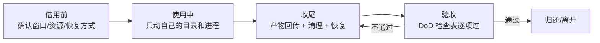

# 借用机器规则（borrowed-etiquette）

> normal/degraded 设计允许使用借用算力，但任何远端机器都不是桌面 companion 的单点依赖：bigstrong（双 4080S）、mac-studio（实验室）、学校云 4090D。
> 总原则一句话：**借来的机器按「随时会失去」对待——不动主人的东西，不留唯一的的东西，用完恢复原样。**
> 由此产生的工程要求（降级方案、产物回传）见 [./degradation.md](./degradation.md) 与 [../03-tracks/voice-clone.md](../03-tracks/voice-clone.md)。

## 借用生命周期

## bigstrong（2×4080 SUPER，借来的）

硬约束：

- **常驻 vLLM 不能动**：`qwen3.8-27B-FP8 TP2, max-num-seqs=3` 是主人的生产服务，不 kill、不改配置、不占它的端口。它是我们的「机会型副脑」，白嫖 endpoint 时控制并发与速率，**绝不当主脑依赖**（且 2026-10-10 实测 API 502 不通，恢复时间看主人）。
- **白天不可动**：训练/大显存任务只在**夜间窗口**进行，且需要先中断 vLLM 时必须获得主人许可。

夜间窗口中断前检查表：

- [ ] 已取得主人许可，约定恢复时间
- [ ] 记录现场：`nvidia-smi`、`ps aux | grep vllm`、vLLM 启动命令/脚本路径（抄下来）
- [ ] 自己的训练任务已设置硬结束时间（早于约定恢复时间 ≥30min）
- [ ] checkpoint 策略生效（每 2h 落盘 + 可续训），中断不丢进度的底线有了

用完恢复验收：

- [ ] 自己的进程全部退出，`nvidia-smi` 无残留显存占用
- [ ] 常驻 vLLM 按记录的命令原样拉起，`/v1/models` 返回正常
- [ ] 告知主人已恢复；临时文件删干净

## mac-studio（M3 Ultra 512GB，实验室机器）

硬约束：

- **随时可收回**：一切设计按「明天就没了」假设——它是首选推理位，但从来不是依赖位（降级方案见 [./degradation.md](./degradation.md)）。
- **不存唯一数据**：模型可从 hf-mirror 重下（见 [./model-fetch.md](./model-fetch.md)）；会话数据、数据集、persona.yaml、训练产物**必须同步回 laptop 或入库 git**。机器上只允许存在「丢了不心疼」的副本。
- **环境改动最小化**：装 ollama/mlx-lm 等走 brew/pip 用户态，不动系统配置；新装的东西记录在案。

退出/被收回前清理检查表：

- [ ] `$MOMO_MODELS_DIR` 下的模型确认是「可重下」的，直接删（腾空间给下一位）
- [ ] 会话数据/日志中需要留的已 rsync 回 laptop
- [ ] 自装服务（mlx_lm.server launchd/自启项）停止并移除
- [ ] 用户目录下 momo 相关文件夹清空，`env`、API key 无残留

## 学校云 4090D（24GB，单次 24h 自动释放）

硬约束：

- **24h 自动释放**：到点机器没了，盘上东西全没。任务设计必须「24h 内能出结果」或「可断点续训」。
- **产物及时回传**：会话开始即记下释放时间，**预留 ≥1h** 用 rsync/scp 回传 checkpoint/模型产物到 laptop；传完再撒手。
- **checkpoint 策略**：训练每 2h 强制落盘，写 `train-manifest.json`（可据此续训）；大任务拆成多个 24h session，manifest + 最新 ckpt 就是接力棒。

4090D session 检查表：

- [ ] session 开始：记录释放时间，设 ≥1h 前回传闹钟
- [ ] 数据/代码/环境按 lock 文件就位（torch/torchaudio 版本对齐——已踩坑）
- [ ] 训练中：checkpoint 按 2h 节奏落盘并抽查可加载
- [ ] 收尾：产物 + manifest 回传 laptop 完成后再结束 session
- [ ] 回写文档：实测吞吐/显存标「实测 + 日期」

## 通用「借用环境 DoD 检查表」

任何一台借来的机器，离开前逐项过：

- [ ] 主人的进程/服务全部原样在线（尤其 bigstrong vLLM）
- [ ] `nvidia-smi` / `ps` 无我方残留进程与显存占用
- [ ] 盘上无我方唯一数据（该回传的回传了，该删的删了）
- [ ] 临时文件、缓存、venv、docker 镜像清理
- [ ] 密钥/token 无残留（`.env`、shell history、配置目录检查一遍）
- [ ] 环境改动可还原或已记录告知主人
- [ ] 本次使用的实测数据（显存/吞吐/延迟）已回写对应文档
