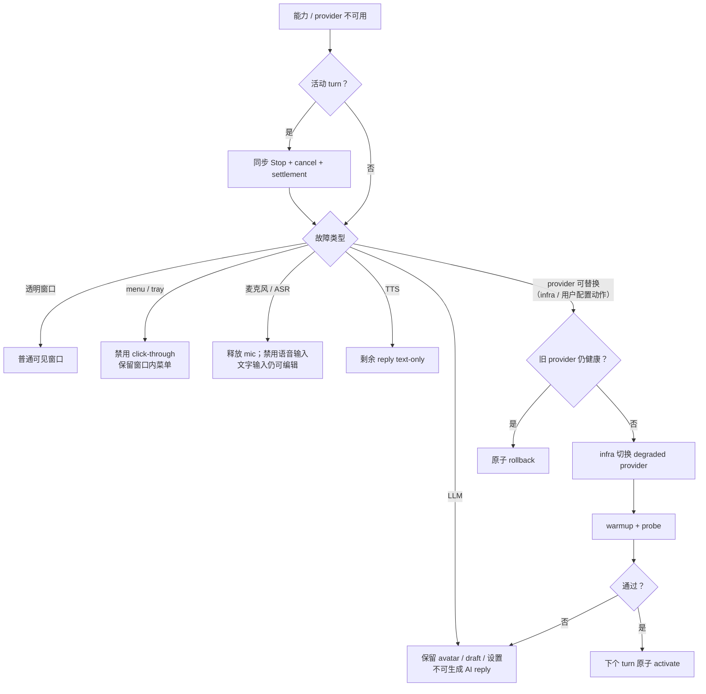

# 当前降级与恢复手册

> 本文是 infra 侧的降级 runbook：档位切换、provider rollback/activate 都经由 `momoctl` 执行；消费侧 momo app 在 provider 不可用时的 UI 降级行为在此一并描述，作为降级决策的验收口径。
> provider 或平台能力不可用时保留窗口/页面、avatar、draft、设置和本地 transcript；LLM ready 时才提供 AI 文字 reply。
>
> **职责边界（ADR-028）**：本文档的「切换/rollback/activate」是 **infra 运维动作**（`momoctl switch`、manifest activate）或用户改配置，不是 app 内自动 failover。app 只持有单 endpoint 配置，provider 不可用时的行为仅限本页的 UI 呈现降级；服务内部的多模型容灾由 provider 服务或 momo-infra gateway 承担。

## 触发

- provider readiness/probe 失败或活动连接断开；
- （桌面壳落地后）透明窗口、Wayland、全局快捷键、system menu 或麦克风能力不可用；
- normal profile 所需机器不可达；
- 用户主动选择更轻的本地模式。

## 决策路径

## 恢复

候选能力恢复后仍走 warmup/probe；成功前不替换当前健康路径。窗口恢复透明模式前转换坐标并 clamp。session 重连只取 snapshot，不播放断线前音频。退出/切换只停止 owned child，attached provider 不受影响。

## 检查

- [ ] 失败切换不会破坏 active 配置。
- [ ] menu 不可用时 click-through 已禁用。
- [ ] LLM 不可用时没有伪装成可工作的 text fallback。
- [ ] 切换前活动 turn 得到显式 cancel。
- [ ] 恢复后第一轮没有 stale stream 或旧音频。
