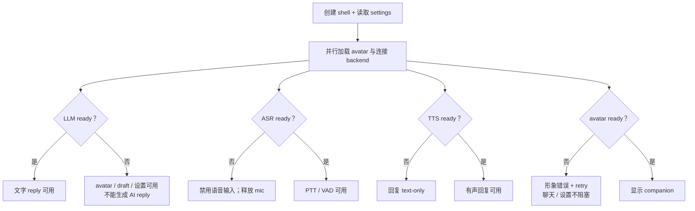

# 当前部署手册

> 本文从 infra 运维视角记录部署口径：normal/degraded 档位（`MOMO_PROFILE`）由 `momoctl switch`/`serve` 执行，消费侧 momo app 与模型服务共用同一套 readiness 语义。
> normal/degraded 使用同一代码，按 readiness 组合桌面宿主、运行时与可用 provider。

## 档位

| 档位 | 桌面 host | runtime | providers | 失败保底 |
|---|---|---|---|---|
| normal | 本机 Tauri；浏览器为 dev preview | 本机 `momod` | owned 本地语音服务 + attached LAN/本地 LLM | provider rollback / 按能力降级 |
| degraded | 同一桌面代码；普通可见窗口 | 本机 `momod` | 轻量 owned provider 或 attached API | avatar、draft、设置；LLM ready 时文字 reply |

## 启动与降级

## process ownership

| 类型 | 例子 | quit / restart |
|---|---|---|
| owned child | app 本次启动的 `momod`、本地 adapter | 只按记录的 process identity 停止 |
| attached provider | 已存在的 LAN LLM、远端 API、用户另行启动服务 | 只断开连接，绝不关闭服务 |

停止时先阻止新输入并同步 Stop，再释放 capture/playback/avatar、取消 turn、保存 transcript/settings，最后停止 owned child。sleep/wake 使用同一释放/重连语义，但不退出应用。

## 平台 fallback

透明窗口或全局快捷键不支持时使用普通可见窗口。system menu/tray 不支持时禁用 click-through，操作入口保留在可见窗口，不依赖不存在的 tray。

## 安全与配置

- endpoint 与密钥留在服务端配置；静态网站不连接本地服务。
- active turn 中不热切 provider；先显式 cancel。
- 配置 draft 或新 provider 先 validate/warmup/probe，成功后原子 activate，失败保持旧配置。
- UI preferences 属本地 settings，不通过 `MOMO_*` 部署 env 分发。

## 冒烟检查

- [ ] 单实例与普通可见窗口 fallback 可恢复。
- [ ] avatar 加载失败有 retry，不阻断设置与已具备的对话能力。
- [ ] LLM/ASR/TTS 分别缺失时只禁用对应能力。
- [ ] sleep/wake 与断线重连只恢复 snapshot，不 replay 声音。
- [ ] quit 未关闭 attached remote provider。
