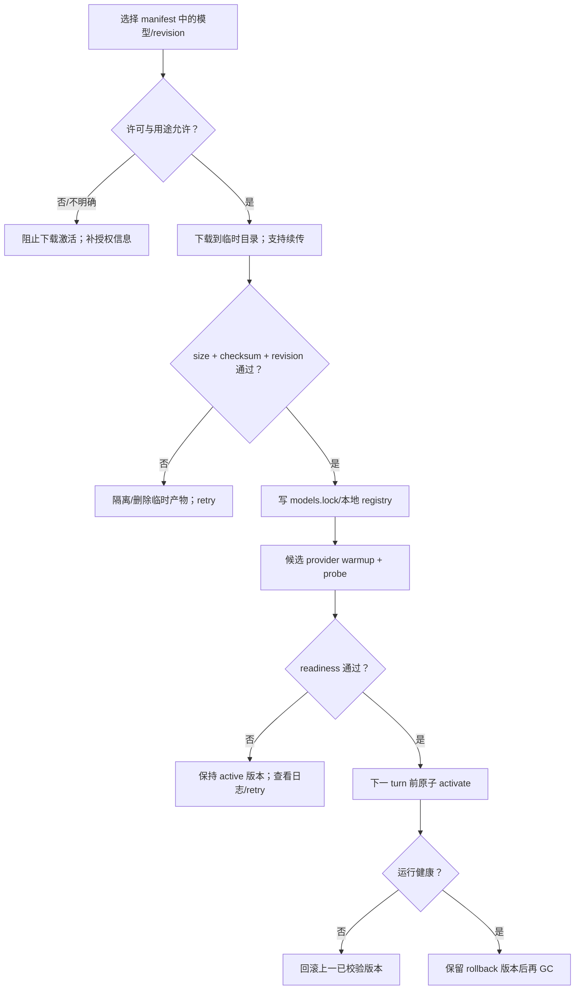

# 推理模型获取、激活与回滚

> 历史事实：2026-10-10 laptop 访问 huggingface.co 不通，当时必须使用 `HF_ENDPOINT=https://hf-mirror.com`。这不是对所有未来环境的性能保证，每次以 probe 为准。

权重存放在 `${MOMO_MODELS_DIR}`，仓库只保存 manifest；Runtime Core、模型与数据各自遵循上游许可。

## fetch lifecycle

## 不变量

- 活动 turn 存在时先显式 cancel，不在回合中换模型。
- checksum/revision/readiness 任一失败都不能覆盖 active。
- `.part`、未登记目录和旧版本只有在无 active/rollback 引用后才能 GC。
- provider 运行时不在线拉权重；下载与 turn 数据路径分离。
- `models.lock` 不记录密钥，下载凭据由独立 secret store 提供。
- `pull` 期间以 `${MOMO_MODELS_DIR}/pull.lock` 占位互斥（create_new 原子）；崩溃残留需手动删除后重试。

## 操作检查

- [x] manifest 包含 repo/revision/files/checksum/destination，及结构化 `license`（`spdx`/`source`，非 SPDX 许可另带 `name`）；非 HF 上游用 `source = "url"` + `files[].url` 直链（如 silero-vad 走 GitHub raw）。
- [ ] 下载失败可续传或干净重试，不把半文件注册为 ready。
- [ ] warmup/probe 失败 active 不变。
- [ ] promotion 后有明确 rollback 目标。
- [ ] 实际大小/性能只有测量后才以“实测 + 日期”回写。
