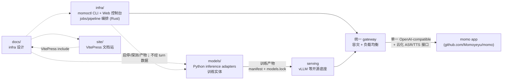

# momo-infra 设计文档

**自有 AI 基础设施：训练 → 评测 → serving 闭环，统一对外 gateway。**

momo-infra 承载 LLM 后训练、ASR/TTS 全训练 pipeline 与模型 serving：推理底座复用 vLLM 等开源实现，自研收敛到统一 gateway（对内容灾与负载均衡、对外单一 OpenAI-compatible 接口）与训练/运维编排（`momoctl`）。终端产品见 [momo 仓](https://github.com/Momoyeyu/momo)，app 通过标准 provider 接口消费本仓能力。

## 仓库地图

## 阅读顺序

1. [momo-infra 定位](./00-context/overview.md)
2. [配置规范](./01-architecture/config.md)

## 目录

| 目录 | 内容 |
|---|---|
| `00-context/` | 定位、研究、infra/模型侧 ADR |
| `02-repos/` | infra 与 models 模块设计 |
| `03-tracks/` | 声线训练轨道（zero-shot/SFT + frozen gate） |
| `04-ops/` | 部署、降级、模型获取、借用机器纪律 |
| `05-management/` | 工程状态与 GitHub Project 协作 |

## 设计不变量

- 复用开源推理底座（vLLM 等），不手搓推理引擎/KV cache；自研只在 gateway 与训练编排。
- infra 不进 turn 数据通路：不读对话内容、不转发音频/文本。
- 一切环境差异走 `MOMO_` env；档位切换 = 改 env 不改代码。
- 模型 activate 前先 checksum + warmup/probe；失败保留 active 版本，promotion 后保留可回滚版本。
- 借来的机器按「随时会失去」对待；密钥/token 不留远端。
- 上游库、模型与素材各自核验许可；本仓许可证不自动覆盖它们。

## 文档规则

- `docs/` 是设计的单一来源，`site/docs/guide/` 通过 include 呈现同一份内容。
- 图先说明组件、状态与操作关系，正文补充图中无法表达的约束。
- 使用小而聚焦的 Mermaid 图；用户操作写清 entry、decision、effect、terminal/retry/cancel。
- 不发明性能数据；历史实测标日期，未验证数据写「待实测」。
